# Windows TFLM 构建与 Arm Development Studio 调试

<!-- SPDX-FileCopyrightText: Copyright 2026 Arm Limited and/or its affiliates <open-source-office@arm.com> -->
<!-- SPDX-License-Identifier: Apache-2.0 -->

Arm ML Embedded Evaluation Kit 提供面向 Cortex-M CPU 和 Ethos-U NPU 的机器学习示例，包括图像分类、语音和目标检测。本页说明如何在原生 Windows 上准备 TensorFlow Lite for Microcontrollers（TFLM）资源、生成 MPS4 SSE-320 FPGA 或 SSE-320 FVP 的 AXF，并在 Arm Development Studio（Arm DS）中调试。ExecuTorch 的 `.pte` 构建见 [Windows ExecuTorch 指南](windows_executorch.md)。

## 准备环境

首次克隆及 FVP 验证步骤见 [Windows 快速入门](windows.md)。

在 Windows 本地磁盘上准备完整项目源码及依赖，安装 Python 3.12（含 `py` 启动器）、Arm DS，以及 AC6 或 Arm Toolchain for Embedded（ATFE）编译器。FVP 调试还需安装 SSE-320 FVP；实板调试需 MPS4 板卡及调试连接。在项目根目录打开 PowerShell，用 `py -3.12 --version` 检查 Python。

脚本依次从 `-CompilerBin`、`MLEK_AC6_BIN` / `MLEK_ATFE_BIN` 环境变量、`PATH` 和本地磁盘常见安装目录查找编译器。`-CompilerBin` 应指向包含 `armclang.exe`（AC6）或 `clang.exe`（ATFE）的 `bin` 目录。

## `build.ps1` 的功能与参数

`scripts/windows/build.ps1` 调用资源准备工具、CMake、Ninja 和交叉编译器。它每次构建前重新配置，以便模型变化时重新生成源代码。脚本结束后恢复临时修改的进程环境变量。

此入口同时支持 `-Framework tflm`（默认）和 `-Framework pte`。
两侧统一的转换、缓存编译、FPGA build 和打包命令见 [二维码复现指南](qrcode_reproduction.md)。

完整的参数、默认值和双平台示例见 [Windows 构建参数手册](windows_build_options.md#firmware)。

TFLM 路线选择 `windows-ac6-mps4`、`windows-atfe-mps4`、`windows-ac6-fvp` 或 `windows-atfe-fvp` 预设。预设固定 `TARGET_PLATFORM=mps4`、`TARGET_SUBSYSTEM=sse-320`、`ML_FRAMEWORK=tflm`，默认 `CMAKE_BUILD_TYPE=Debug`。`FPGA` 设置 `FPGA_PLATFORM_SSE_320=ON`，`FVP` 设置为 `OFF`。使用 `-BuildType Release` 构建 Release；旧的 `-CMakeArgs` 覆盖仍可使用。Debug 构建的性能不代表 Release 性能。

尺寸、类别数及激活区参数仅在相应用例声明了这些 CMake 选项时才有意义。`yolov8_detection` 和 `yolov8_pose` 的 Setup 只安装所需 Python 包，模型、图片和标签由用户提供。CMake 会缓存模型路径及覆盖值；恢复默认模型时建议使用新构建目录。

## 准备资源和构建

从项目根目录先执行 Setup（需要网络连接）：

```powershell
powershell.exe -NoProfile -ExecutionPolicy Bypass -File scripts/windows/build.ps1 `
    -Action Setup -UseCase img_class
```

共用的 CMake/Ninja 安装在 `resources_downloaded/windows-tools/env`，TFLM Python 环境及下载资源位于 `resources_downloaded/windows`。随后构建默认的 AC6、FPGA、Debug 固件：

```powershell
powershell.exe -NoProfile -ExecutionPolicy Bypass -File scripts/windows/build.ps1 `
    -Action Build -Toolchain AC6 -Target FPGA -UseCase img_class
```

ATFE 与 FVP 的示例：

```powershell
powershell.exe -NoProfile -ExecutionPolicy Bypass -File scripts/windows/build.ps1 `
    -Action Build -Toolchain ATFE -Target FVP -UseCase img_class `
    -BuildDirectory build/my-atfe-fvp -Jobs 8
```

替换模型时添加 `-ModelPath "path-to-model"`。用于 Ethos-U 的模型应预先按目标 NPU 配置生成；FVP 默认 U85 Z1024（FVP 模型也须设置为 1024 MACs），MPS4 FPGA 使用 U85 Z1024。AXF 位于 `<BuildDirectory>/bin/mlek_<UseCase>.axf`。FVP 和 FPGA 固件不能互换。

## QR-code TFLite 与可变 cache 构建

### 从 ONNX 导出 NHWC INT8 模型

现有 `scripts/export_qrcode_onnx.py` 可通过 `--tflite-backend onnx2tf` 在原生 Windows
导出二维码模型。此后端使用 onnx2tf 的 `tf_converter`，无需 PyTorch、ExecuTorch 或
LiteRT Torch。默认后端仍为 `litert-torch`，原 PTE 路线保持不变。

使用单独的 Python 3.12 环境，避免改变现有固件构建依赖。下面复用已经通过
`build.ps1 -Action Setup` 创建的 Python 环境来启动 venv：

```powershell
& .\resources_downloaded\windows\env\Scripts\python.exe -m venv `
    .\resources_downloaded\windows-onnx2tf\env
& .\resources_downloaded\windows-onnx2tf\env\Scripts\python.exe -m pip install `
    -r .\scripts\windows\requirements-qrcode-onnx2tf.txt
```

从原始 ONNX 转换、校准、验证，并按 384 KiB 预算运行 Vela：

```powershell
$cacheKiB = 384
$output = '.\resources_downloaded\yolo_QRcode\onnx2tf_nhwc_384k'
& .\resources_downloaded\windows-onnx2tf\env\Scripts\python.exe `
    .\scripts\export_qrcode_onnx.py `
    --format tflite --tflite-backend onnx2tf `
    --model .\resources_downloaded\yolo_QRcode\best.onnx `
    --calibration-dir .\resources\object_detection\samples_QRcode `
    --calibration-limit 0 --validation-limit 6 `
    --arena-cache-size ($cacheKiB * 1024) --output-dir $output
```

此后端直接转换原 ONNX，不应用 PTE 专用的 ReLU/clamp 改写。输入和三个四维检测头
必须为 NHWC，单通道辅助输出保留原形状。校准采用 RGB/255，`mlek-crop` 按固件图片
生成工具居中裁剪；旧导出路线的图片处理保持原行为。转换器只操作输出目录内的
ONNX 副本。FP32 输出需通过原 ONNX 数值一致性检查，INT8 输出需通过检测分数及框
IoU 检查，Vela 产物需通过全 NPU、INT8 接口检查，才标记导出完成。

输出模型为 `$output/tflite/best_int8.tflite`，上板构建使用
`$output/tflm_Dedicated_Sram/best_int8_vela.tflite`。`export_report.json` 记录转换、
接口和数值验证结果；Vela 报告位于 `tflm_Dedicated_Sram/`。修改 cache 时只需对已经
量化的 `best_int8.tflite` 重跑 Vela，无需重新校准。下述固件构建命令继续适用。

默认样本目录只有六张图片，未指定 `--validation-dir` 时校准与验证集会重叠。
这里的数值检查用于确认转换行为，不代替独立标注数据集的精度评估或板上性能测量。

### 构建固件

二维码模型继续使用 `scripts/windows/build.ps1`，无需专用构建脚本。
`-ModelPath` 指定已经过 Vela 编译的 TFLite；`ETHOS_U_NPU_CACHE_SIZE` 的单位为字节，
通过 `-CMakeArgs` 传入。它设置固件预留的 fast cache，不会重新编译模型。
选择与模型 Vela 编译预算匹配的容量，并为每个模型、容量及目标使用独立构建目录。

从项目根目录的 PowerShell 构建 384 KiB Dedicated SRAM / U85 Z1024 / TA Mid 固件：

```powershell
$cacheKiB = 384
$model = '.\resources_downloaded\yolo_QRcode\build_384k\best_int8_new_vela.tflite'
$target = 'FPGA'
$compilerBin = 'C:/Program Files/Arm/Development Studio 2026.0-1/sw/atfe-pro22.1.0/bin'

.\scripts\windows\build.ps1 `
    -Action Build -Toolchain ATFE -Target $target -CompilerBin $compilerBin `
    -UseCase yolov8_detection -ModelPath $model `
    -InputPath resources/object_detection/samples_QRcode/1.png `
    -LabelsPath resources_downloaded/yolo_QRcode/labels.txt `
    -ImageSize 256 -NumClasses 15 -ActivationBufferSize 0x00400000 `
    -BuildDirectory "build/qrcode-tflm-$target-${cacheKiB}k-BW" -Jobs 8 `
    -CMakeArgs @(
        "-DETHOS_U_NPU_CACHE_SIZE=$($cacheKiB * 1024)",
        '-DETHOS_U_NPU_ID=U85', '-DETHOS_U_NPU_CONFIG_ID=Z1024',
        '-DETHOS_U_NPU_TIMING_ADAPTER_ENABLED=ON',
        '-DTA_CONFIG_FILE=ta_config_u85_sys_dram_mid',
        '-DETHOS_U_NPU_PMU_GROUP=BW', '-DINTERACTIVE_MODE=OFF',
        '-DUSE_SINGLE_INPUT=ON', '-DCMAKE_BUILD_TYPE=Release'
    )
```

`$cacheKiB * 1024` 将 KiB 转为字节，例如 384 KiB 为 393216 字节。
更换模型时修改 `$model` 和 `$cacheKiB`；构建 FVP 固件时将 `$target` 改为 `FVP`。
新构建目录中 U85 默认使用 `Dedicated_Sram`，该例用于 Dedicated 模型。
可以通过 `-MemoryMode Dedicated_Sram`、`-MemoryMode Shared_Sram` 或
`-MemoryMode Sram_Only` 显式选择与模型匹配的模式。Shared SRAM 模型的
`-ActivationBufferSize` 会在 SRAM 中预留 tensor arena，而 Dedicated SRAM 模型在 DDR
中预留 arena；Shared SRAM 不需要独立的 fast-cache buffer。
标签文件需包含按训练顺序排列的 15 个标签。

构建只产生正常固件文件：`bin/mlek_yolov8_detection.axf`、
`bin/sectors/yolov8_detection/{boot,bram,ddr}.bin` 和 `bin/sectors/images.txt`。
4 MiB activation buffer 是 DDR arena 的预留容量；SRAM fast cache 单独配置。
`BW` 组同时记录 SRAM/EXT 读写 beats、两路径读请求 stall 和 AO 输出缓冲 stall，
详见 [周期日志与 PMU](windows_executorch.md#pose-的周期日志与-pmu)。

冷构建不需要引用其他 build 目录的依赖缓存，删除当前构建目录后可直接重跑原命令。
如果 Windows 上 CMake 在解压 FlatBuffers、gemmlowp 或 ruy 后报告 `file RENAME failed`，
构建入口会尝试移动本次已经校验并解压的源码，然后使用当前构建目录内的
`FETCHCONTENT_SOURCE_DIR_*` 继续配置。每个依赖最多恢复一次，目录移动最多尝试五次；
网络、压缩包校验和编译错误仍会中止构建。恢复不会修改依赖子模块或引用其他 build 目录。

## Arm DS 配置

### 导入项目

在 Arm DS 中选择 `File → Open Projects from File System...`，点击 `Directory...` 并选取包含 `.project` 的项目根目录。待向导识别出项目后选中它，点击 `Finish`；随后可在 `Project Explorer` 中看到项目文件。


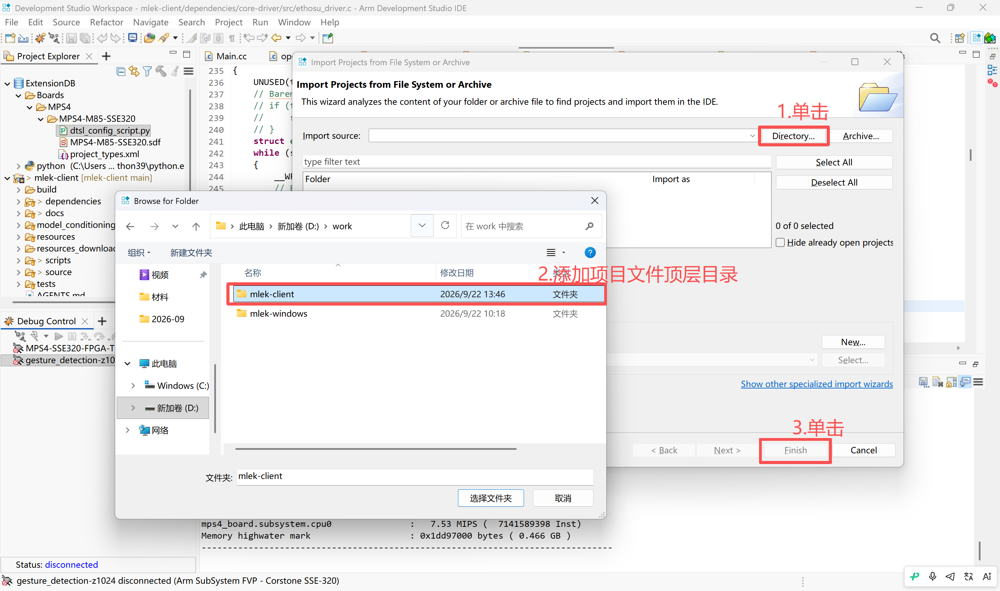

### 从 Arm DS 构建

在 `Run → External Tools → External Tools Configurations...` 中新建 `Program`。不同版本的菜单名称可能略有差异。
下图依次显示菜单入口和 `Program → New Configuration`：

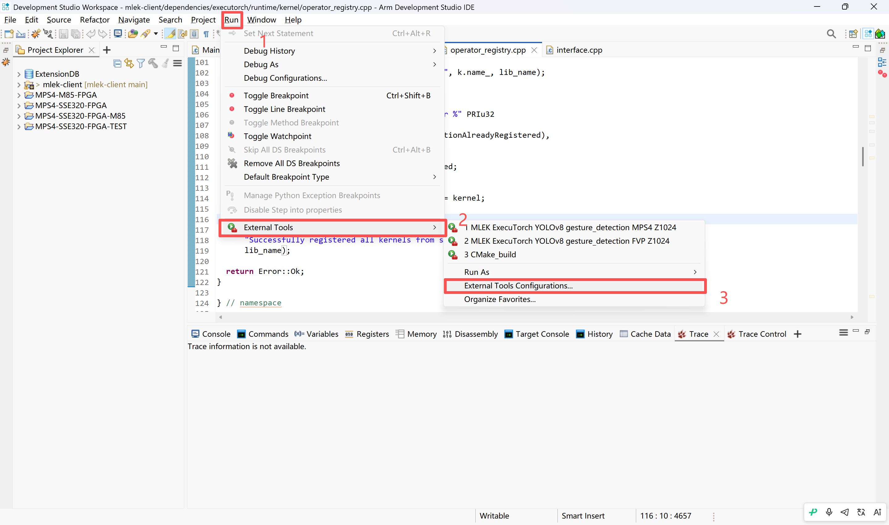


| 字段 | 默认示例 |
| --- | --- |
| Name | `MLEK TFLM AC6 FPGA Debug` |
| Location | `C:\Windows\System32\WindowsPowerShell\v1.0\powershell.exe` |
| Working Directory | 项目根目录，例如 `D:/work/mlek-client`；已导入 Arm DS 工程时也可用 `${workspace_loc:/mlek-client}`。 |
| Arguments | 下方单行参数。 |

```text
-NoProfile -ExecutionPolicy Bypass -File "scripts/windows/build.ps1" -Action Build -Toolchain AC6 -Target FPGA -UseCase img_class -BuildDirectory "build/windows-ac6-mps4" -Jobs 4
```

点击 `Apply`、`Run`，在 Console 中确认构建完成。首次使用可另建 Setup 配置，Arguments 为 `-NoProfile -ExecutionPolicy Bypass -File "scripts/windows/build.ps1" -Action Setup -UseCase img_class`。切换工具链、目标或用例时同步修改名称、参数和构建目录。

在 `Main` 页填写名称、PowerShell 路径、项目根目录及构建参数，然后点击 `Apply`、`Run`：


### 加载 AXF 调试

在 `Debug Configurations` 或 `New Debug Connection` 中建立目标连接，按以下默认设置填写：

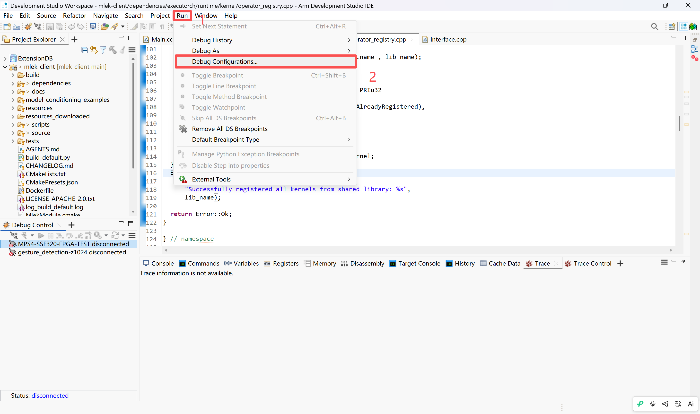

| 配置项 | FVP | MPS4 FPGA |
| --- | --- | --- |
| Connection | Model Connection，选择 SSE-320 FVP。若未列出，用 `Add a new model` 指向本机 `FVP_Corstone_SSE-320.exe`。 | 实际板卡的调试连接。 |
| Processor | Cortex-M85 裸机目标。 | 板卡上的 Cortex-M85。 |
| Application / Symbols | `build/windows-ac6-fvp/bin/mlek_img_class.axf`，或实际 FVP 构建目录中的 AXF。 | `build/windows-ac6-mps4/bin/mlek_img_class.axf`，或实际 FPGA 构建目录中的 AXF。 |
| Load | 加载所选 AXF 的程序和符号。 | 板内先烧录程序；Arm DS 连接时仅加载同一次构建的 AXF 符号，详见下节。 |
| Debug | 可在 `main` 设置断点，再使用 Continue / Step。 | 同左。 |

以 FVP 为例，在 `Generic Arm C/C++ Application` 下新建配置，选择 SSE-320 的 Cortex-M85，并按实际需要填写 FVP 参数；在 `Files` 页选择对应 AXF，在 `Debugger` 页可选择从 `main` 开始调试，最后点击 `Apply`、`Debug`。

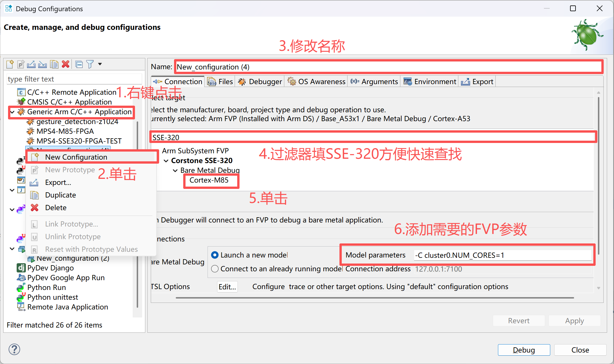
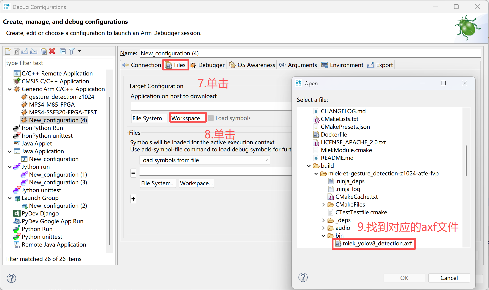
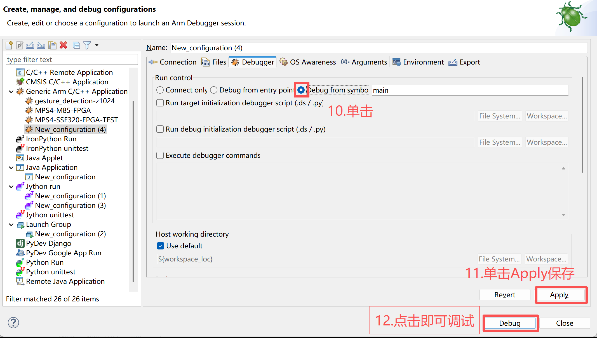

若要采集 **FVP trace**，在连接页打开 `DTSL Options`，于 `Trace Buffer` 选择 `Model Trace` 并设置缓冲区大小，再于 `Core Trace` 勾选 `Enable Cortex-M85 trace`，保存配置。


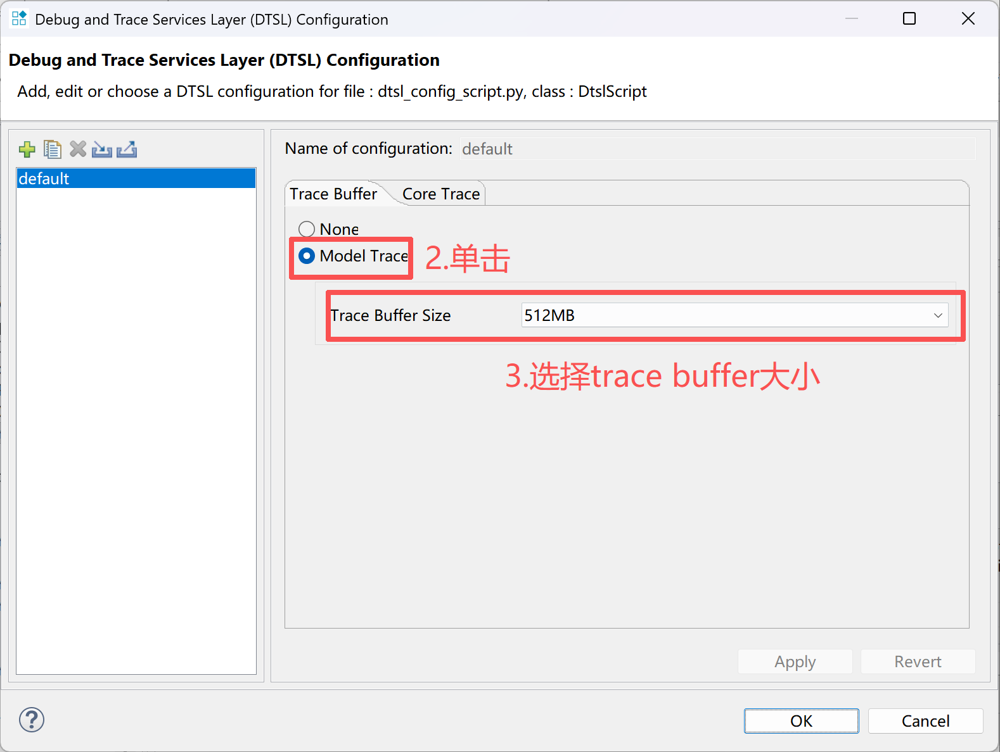
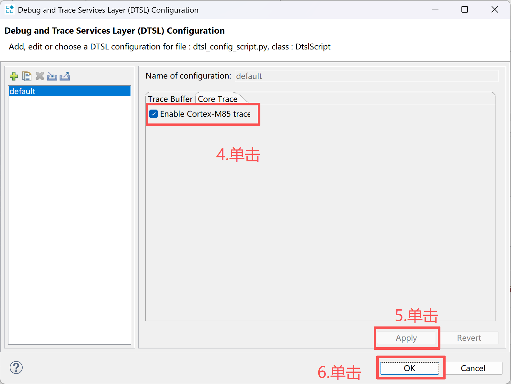

ATFE 或其他用例要换成其实际 AXF。`-Target` 必须与 Debug Connection 一致。External Tool 构建与 Debug Connection 是独立配置；源码或模型变化后先重新构建，再启动调试。

### MPS4 实板调试

#### 1. 编译与板上镜像

构建目录中的 `CMAKE_BUILD_TYPE=Debug` 表示程序按 Debug 配置构建，便于源码级调试；它**不会自动打开板上的硬件调试权限**。

已验证可行的方式是：**将本次构建对应的程序烧入板内**，然后在 Arm DS 中连接目标，并在 `Files` 页的 **Load symbols from file** 填入同一次构建生成的 AXF。`Application on host to download` 留空，避免连接时再次下载镜像。板内程序与 AXF 不对应时，源码定位和断点就不可靠。

#### 2. Cortex-M85 trace

在调试连接的 `DTSL Options` 中启用 Cortex-M85 trace 等相应配置，以保证 trace 可用。完成配置后再连接目标并检查 trace 数据。

连接后可从 `Window → Show View` 打开 `Trace` 和 `Trace Control`。修改实板 DTSL 设置前先断开连接，再打开 `DTSL Options`：在 `Trace Capture` 中选择 `On Chip Trace Buffer (CSTMC/ETF)`，在 `Cortex-M85` 页启用图示的 core trace、时间戳和 `Cycle Accurate`，在 `ITM` 页启用 `CSITM_Cortex-M85 trace`，最后保存。

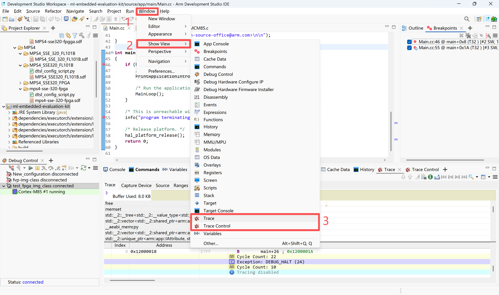
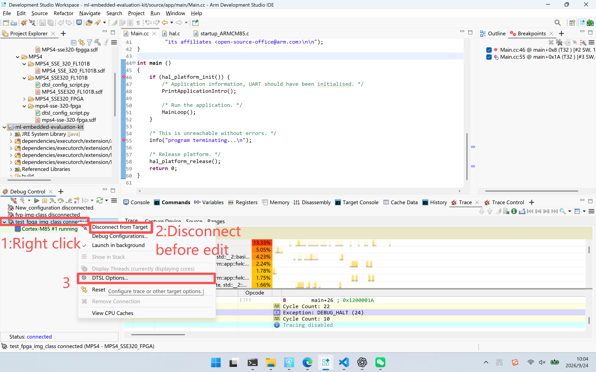
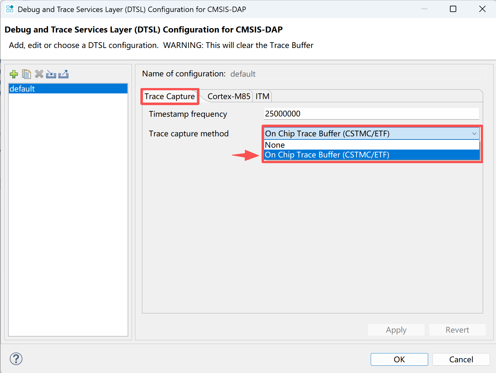
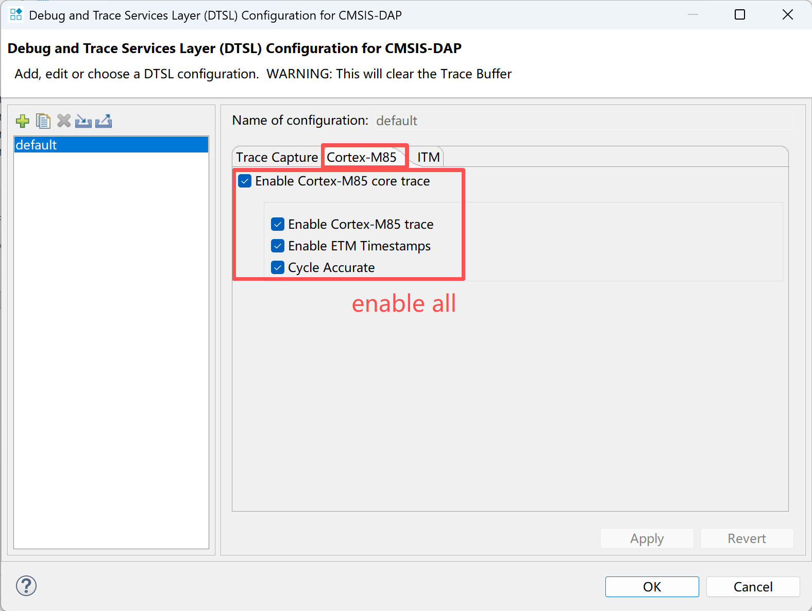
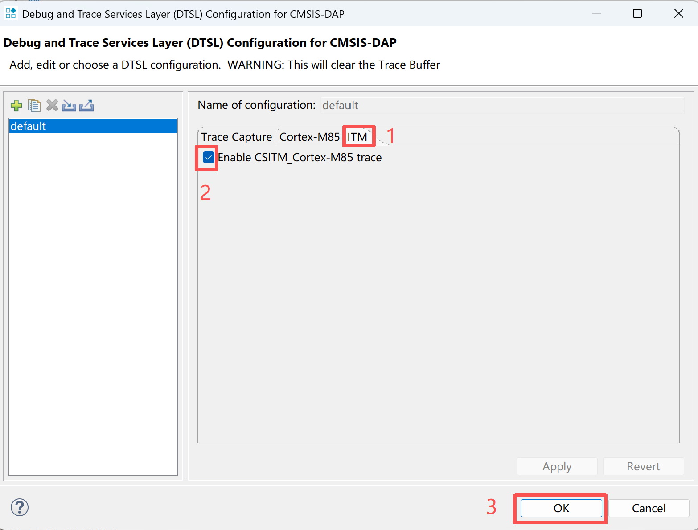

FVP 的启动参数应与固件配置一致：U85 Z1024 使用 `-C mps4_board.subsystem.ethosu.num_macs=1024`。在 Arm DS 的模型连接配置中设置同名参数；CMake 的 MPS4 FVP 集成测试会根据 `ETHOS_U_NPU_CONFIG_ID` 自动传入 MAC 数。

## YOLOv8 Pose TFLite 构建与调试

在项目根目录的 PowerShell 中执行。首次准备环境：

```powershell
.\scripts\windows\build.ps1 -Action Setup -UseCase yolov8_pose
```

Setup 只安装 Python 工具，不下载或导出 Pose 模型。模型由用户手动放到
`resources_downloaded/yolov8_pose/`，该目录已被 Git 忽略；图片与标签仍使用
`resources/yolov8_pose/samples/` 和 `resources/yolov8_pose/hand_pose.yaml`。
旧的 `packed_dedicated_128k` 模型已移除。

默认模型为 `model_int8_vela_u85_1024_Dedicated_Sram_256k.tflite`，默认 NPU 缓存为
256 KiB（`262144` 字节）。`-ModelPath` 可指定其他模型。当前默认模型的输入为
FP32 NCHW `[1,3,224,224]`，输出为单个 FP32 `[1,68,1029]` 张量；应用默认使用
PACKED 输出和归一化坐标。更换模型时按导出设置核对
`yolov8_pose_OUTPUT_TOPOLOGY`、`yolov8_pose_COORDINATES_NORMALIZED` 和缓存大小。

### 单次调用：一个模型构建 FVP 固件

```powershell
$compilerBin = 'C:/Program Files/Arm/Development Studio 2026.0-1/sw/atfe-pro22.1.0/bin'
$fvp = 'C:/Program Files/Arm/FVP_Corstone_SSE-320/models/Win64_VC2019/FVP_Corstone_SSE-320.exe'
$model = '.\resources_downloaded\yolov8_pose\model_int8_vela_u85_1024_Dedicated_Sram_256k.tflite'
.\scripts\windows\build.ps1 -Action Build -Toolchain ATFE -Target FVP `
    -UseCase yolov8_pose -CompilerBin $compilerBin -ModelPath $model `
    -BuildDirectory build/windows-atfe-fvp-yolov8_pose-256k `
    -CMakeArgs @('-DETHOS_U_NPU_TIMING_ADAPTER_ENABLED=ON',
        '-DBUILD_FVP_TESTS=ON', "-DFVP_PATH=$fvp")
```

一次 Build 会先配置 CMake、生成并嵌入所选模型，再编译固件。上面的 256 KiB 默认模型
可以省略 `-ModelPath`。运行 FVP 测试是单独一步：

```powershell
& .\resources_downloaded\windows-tools\env\Scripts\ctest.exe `
    --test-dir .\build\windows-atfe-fvp-yolov8_pose-256k `
    -R mlek_yolov8_pose_fvp_test -V
```

### 单次调用：一个模型构建 FPGA 固件

使用上面定义的 `$compilerBin` 和 `$model`：

```powershell
.\scripts\windows\build.ps1 -Action Build -Toolchain ATFE -Target FPGA `
    -UseCase yolov8_pose -CompilerBin $compilerBin -ModelPath $model `
    -BuildDirectory build/windows-atfe-fpga-yolov8_pose-256k `
    -CMakeArgs @('-DETHOS_U_NPU_TIMING_ADAPTER_ENABLED=ON')
```

FVP 与 FPGA 可以选用同一份按 U85 Z1024、Dedicated SRAM 编译的模型，但必须分别构建
固件。AXF 在各自的 `<BuildDirectory>/bin/mlek_yolov8_pose.axf`；FPGA 的板上镜像在
`bin/sectors/`。编译完成后按本页的 Arm DS 与 MPS4 流程加载对应固件，构建命令不会烧板。

### 批量调用：多个缓存配置分别构建 FVP 和 FPGA

循环调用现有入口即可。以下选择本地已有的 Z1024、Dedicated SRAM 模型，每个模型与目标
有独立构建目录；`$sizesKiB` 和 `$targets` 可按需要缩减。

```powershell
$ErrorActionPreference = 'Stop'
$compilerBin = 'C:/Program Files/Arm/Development Studio 2026.0-1/sw/atfe-pro22.1.0/bin'
$sizesKiB = @(64, 128, 256, 384, 768)
$targets = @('FVP', 'FPGA')
foreach ($size in $sizesKiB) {
    $model = ".\resources_downloaded\yolov8_pose\model_int8_vela_u85_1024_Dedicated_Sram_${size}k.tflite"
    if (-not (Test-Path -LiteralPath $model)) { throw "Missing model: $model" }
    foreach ($target in $targets) {
        .\scripts\windows\build.ps1 -Action Build -Toolchain ATFE -Target $target `
            -UseCase yolov8_pose -CompilerBin $compilerBin -ModelPath $model `
            -BuildDirectory "build/pose-tflm-$target-ded-${size}k" `
            -CMakeArgs @("-DETHOS_U_NPU_CACHE_SIZE=$($size * 1024)",
                '-DETHOS_U_NPU_TIMING_ADAPTER_ENABLED=ON')
    }
}
```

流程是先准备环境与模型，再逐个配置、编译，最后分别执行 FVP 测试或实板加载。
上面的批量命令只构建；需要自动 FVP 测试时，在 FVP 调用中追加
`-DBUILD_FVP_TESTS=ON`、`-DFVP_PATH=...`，再对对应目录运行 CTest。
这些命令不重新导出模型。Shared SRAM 模型应单独设置内存布局，不能只替换 Dedicated 文件名。

迁移后首次构建使用新目录，避免旧 CMake 缓存继续指向已删除的模型。
脚本默认 Pose 缓存为 256 KiB，默认 TA 为 `ta_config_u85_sys_dram_1024`；每次配置清理
`SRAM_*`、`EXT_*` 缓存，最后应用 `-CMakeArgs` 覆盖。直接调用 CMake 时设置
`RESOURCES_PATH` 到模型所在的资源根目录，并显式传入
`-DETHOS_U_NPU_CACHE_SIZE=262144`；Windows 脚本会显式传入共同模型目录的默认模型路径。
CPU profiling 默认开启，详见 [周期日志与 PMU](windows_executorch.md#pose-的周期日志与-pmu)。
