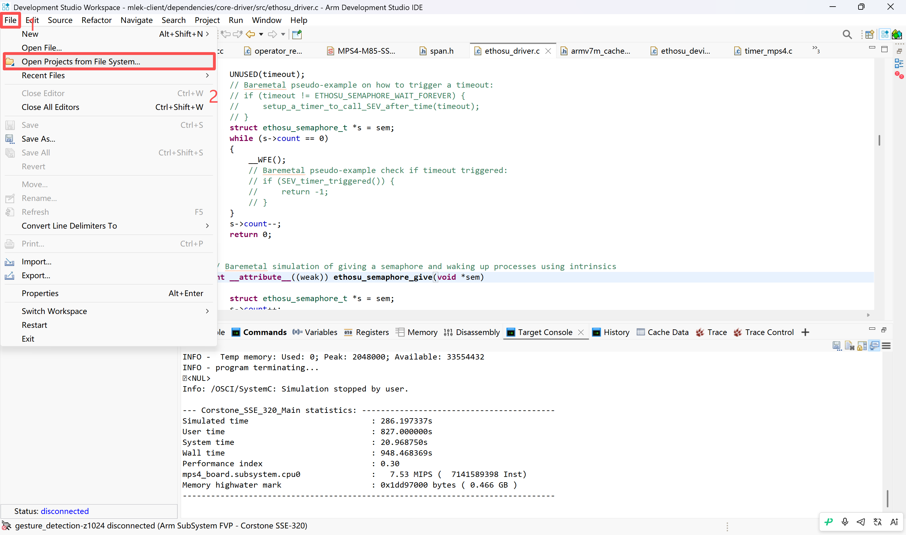
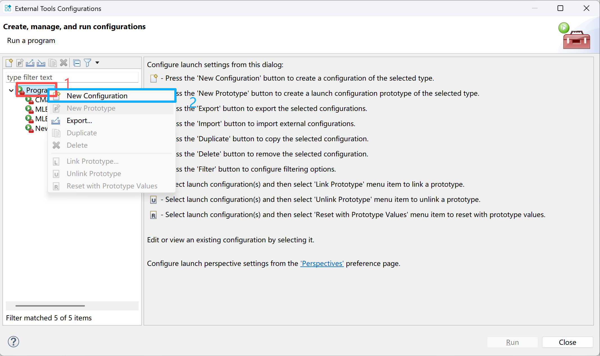
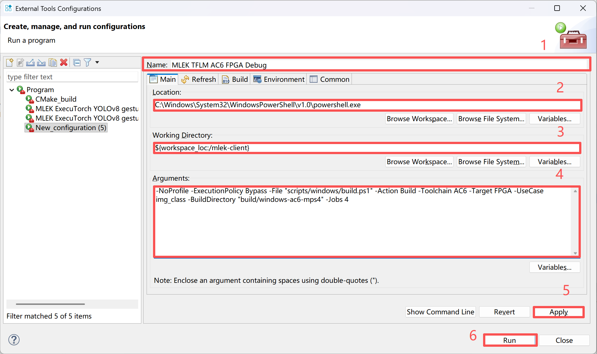
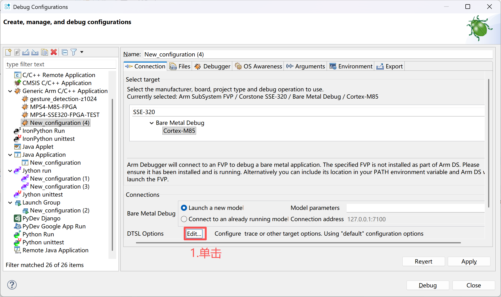

# Windows TFLM 构建与 Arm Development Studio 调试

<!-- SPDX-FileCopyrightText: Copyright 2026 Arm Limited and/or its affiliates <open-source-office@arm.com> -->
<!-- SPDX-License-Identifier: Apache-2.0 -->

Arm ML Embedded Evaluation Kit 提供面向 Cortex-M CPU 和 Ethos-U NPU 的机器学习示例，包括图像分类、语音和目标检测。本页说明如何在原生 Windows 上准备 TensorFlow Lite for Microcontrollers（TFLM）资源、生成 MPS4 SSE-320 FPGA 或 SSE-320 FVP 的 AXF，并在 Arm Development Studio（Arm DS）中调试。ExecuTorch 的 `.pte` 构建见 [Windows ExecuTorch 指南](windows_executorch.md)。

## 准备环境

在 Windows 本地磁盘上准备完整项目源码及依赖，安装 Python 3.12（含 `py` 启动器）、Arm DS，以及 AC6 或 Arm Toolchain for Embedded（ATFE）编译器。FVP 调试还需安装 SSE-320 FVP；实板调试需 MPS4 板卡及调试连接。在项目根目录打开 PowerShell，用 `py -3.12 --version` 检查 Python。

脚本依次从 `-CompilerBin`、`MLEK_AC6_BIN` / `MLEK_ATFE_BIN` 环境变量、`PATH` 和本地磁盘常见安装目录查找编译器。`-CompilerBin` 应指向包含 `armclang.exe`（AC6）或 `clang.exe`（ATFE）的 `bin` 目录。

## `build.ps1` 的功能与参数

`scripts/windows/build.ps1` 调用资源准备工具、CMake、Ninja 和交叉编译器。它每次构建前重新配置，以便模型变化时重新生成源代码。脚本结束后恢复临时修改的进程环境变量。

| 参数 | 默认值 | 说明 |
| --- | --- | --- |
| `-Action` | `Build` | `Setup` 安装工具并准备资源；`Configure` 只配置和生成；`Build` 先配置再编译；`All` 执行全部步骤。首次使用先执行 Setup。 |
| `-Toolchain` | `AC6` | `AC6` 或 `ATFE`。两种编译器使用不同构建目录。 |
| `-Target` | `FPGA` | `FPGA` 为 MPS4 SSE-320 实板；`FVP` 为 SSE-320 虚拟平台。 |
| `-UseCase` | `img_class` | 应用用例，传给 CMake 的 `USE_CASE_BUILD`；Setup 按此用例准备资源。 |
| `-CompilerBin` | 自动查找 | 编译器 `bin` 目录；Setup 不需要交叉编译器。 |
| `-ModelPath` | 用例默认模型 | `.tflite` 路径，映射到 `<UseCase>_MODEL_PATH`。 |
| `-InputPath` | 用例默认输入 | 样本文件或目录，映射到 `<UseCase>_FILE_PATH`。 |
| `-LabelsPath` | 用例默认标签 | 标签文件，映射到 `<UseCase>_LABELS_YAML_FILE`。 |
| `-ImageSize` | 不覆盖 | 图像尺寸，允许 1–4096；映射到 `<UseCase>_IMAGE_SIZE`。 |
| `-NumClasses` | 不覆盖 | 类别数，允许 1–1000；映射到 `<UseCase>_NUM_CLASSES`。 |
| `-ActivationBufferSize` | 不覆盖 | 激活区大小，传给 `<UseCase>_ACTIVATION_BUF_SZ`。 |
| `-BuildDirectory` | `build/windows-<toolchain>-<target>` 对应目录 | 构建目录；相对路径从项目根目录解析。 |
| `-CMakeArgs` | 空 | 额外 `-DNAME=value` 定义；可配置 TA、FVP 测试及 Pose PMU。框架、平台和工具链由命名参数控制。 |
| `-Jobs` | `4` | Setup 下载及编译并行数，允许 1–128。 |

脚本选择 `windows-ac6-mps4`、`windows-atfe-mps4`、`windows-ac6-fvp` 或 `windows-atfe-fvp` 预设。预设固定 `TARGET_PLATFORM=mps4`、`TARGET_SUBSYSTEM=sse-320`、`ML_FRAMEWORK=tflm` 和 `CMAKE_BUILD_TYPE=Debug`。`FPGA` 设置 `FPGA_PLATFORM_SSE_320=ON`，`FVP` 设置为 `OFF`。**Debug 默认开启**，脚本没有单独开关；需要其他构建类型时，使用独立构建目录直接调用 CMake。Debug 构建的性能不代表 Release 性能。

尺寸、类别数及激活区参数仅在相应用例声明了这些 CMake 选项时才有意义。`yolov8_detection` 和 `yolov8_pose` 的 Setup 只安装所需 Python 包，模型、图片和标签由用户提供。CMake 会缓存模型路径及覆盖值；恢复默认模型时建议使用新构建目录。

## 准备资源和构建

从项目根目录先执行 Setup（需要网络连接）：

```powershell
powershell.exe -NoProfile -ExecutionPolicy Bypass -File scripts/windows/build.ps1 `
    -Action Setup -UseCase img_class
```

共用的 CMake/Ninja 安装在 `resources_downloaded/windows-tools/env`，TFLM Python 环境及下载资源位于 `resources_downloaded/windows`。随后构建默认的 AC6、FPGA、Debug 固件：

```powershell
powershell.exe -NoProfile -ExecutionPolicy Bypass -File scripts/windows/build.ps1 `
    -Action Build -Toolchain AC6 -Target FPGA -UseCase img_class
```

ATFE 与 FVP 的示例：

```powershell
powershell.exe -NoProfile -ExecutionPolicy Bypass -File scripts/windows/build.ps1 `
    -Action Build -Toolchain ATFE -Target FVP -UseCase img_class `
    -BuildDirectory build/my-atfe-fvp -Jobs 8
```

替换模型时添加 `-ModelPath "path-to-model"`。用于 Ethos-U 的模型应预先按目标 NPU 配置生成；FVP 默认 U85 Z1024（FVP 模型也须设置为 1024 MACs），MPS4 FPGA 使用 U85 Z1024。AXF 位于 `<BuildDirectory>/bin/mlek_<UseCase>.axf`。FVP 和 FPGA 固件不能互换。

## Arm DS 配置

### 导入项目

在 Arm DS 中选择 `File → Open Projects from File System...`，点击 `Directory...` 并选取包含 `.project` 的项目根目录。待向导识别出项目后选中它，点击 `Finish`；随后可在 `Project Explorer` 中看到项目文件。




### 从 Arm DS 构建

在 `Run → External Tools → External Tools Configurations...` 中新建 `Program`。不同版本的菜单名称可能略有差异。
下图依次显示菜单入口和 `Program → New Configuration`：




| 字段 | 默认示例 |
| --- | --- |
| Name | `MLEK TFLM AC6 FPGA Debug` |
| Location | `C:\Windows\System32\WindowsPowerShell\v1.0\powershell.exe` |
| Working Directory | 项目根目录，例如 `D:/work/mlek-client`；已导入 Arm DS 工程时也可用 `${workspace_loc:/mlek-client}`。 |
| Arguments | 下方单行参数。 |

```text
-NoProfile -ExecutionPolicy Bypass -File "scripts/windows/build.ps1" -Action Build -Toolchain AC6 -Target FPGA -UseCase img_class -BuildDirectory "build/windows-ac6-mps4" -Jobs 4
```

点击 `Apply`、`Run`，在 Console 中确认构建完成。首次使用可另建 Setup 配置，Arguments 为 `-NoProfile -ExecutionPolicy Bypass -File "scripts/windows/build.ps1" -Action Setup -UseCase img_class`。切换工具链、目标或用例时同步修改名称、参数和构建目录。

在 `Main` 页填写名称、PowerShell 路径、项目根目录及构建参数，然后点击 `Apply`、`Run`：



### 加载 AXF 调试

在 `Debug Configurations` 或 `New Debug Connection` 中建立目标连接，按以下默认设置填写：


| 配置项 | FVP | MPS4 FPGA |
| --- | --- | --- |
| Connection | Model Connection，选择 SSE-320 FVP。若未列出，用 `Add a new model` 指向本机 `FVP_Corstone_SSE-320.exe`。 | 实际板卡的调试连接。 |
| Processor | Cortex-M85 裸机目标。 | 板卡上的 Cortex-M85。 |
| Application / Symbols | `build/windows-ac6-fvp/bin/mlek_img_class.axf`，或实际 FVP 构建目录中的 AXF。 | `build/windows-ac6-mps4/bin/mlek_img_class.axf`，或实际 FPGA 构建目录中的 AXF。 |
| Load | 加载所选 AXF 的程序和符号。 | 板内先烧录程序；Arm DS 连接时仅加载同一次构建的 AXF 符号，详见下节。 |
| Debug | 可在 `main` 设置断点，再使用 Continue / Step。 | 同左。 |

以 FVP 为例，在 `Generic Arm C/C++ Application` 下新建配置，选择 SSE-320 的 Cortex-M85，并按实际需要填写 FVP 参数；在 `Files` 页选择对应 AXF，在 `Debugger` 页可选择从 `main` 开始调试，最后点击 `Apply`、`Debug`。


若要采集 **FVP trace**，在连接页打开 `DTSL Options`，于 `Trace Buffer` 选择 `Model Trace` 并设置缓冲区大小，再于 `Core Trace` 勾选 `Enable Cortex-M85 trace`，保存配置。




ATFE 或其他用例要换成其实际 AXF。`-Target` 必须与 Debug Connection 一致。External Tool 构建与 Debug Connection 是独立配置；源码或模型变化后先重新构建，再启动调试。

### MPS4 实板调试

#### 1. 编译与板上镜像

构建目录中的 `CMAKE_BUILD_TYPE=Debug` 表示程序按 Debug 配置构建，便于源码级调试；它**不会自动打开板上的硬件调试权限**。

已验证可行的方式是：**将本次构建对应的程序烧入板内**，然后在 Arm DS 中连接目标，并在 `Files` 页的 **Load symbols from file** 填入同一次构建生成的 AXF。`Application on host to download` 留空，避免连接时再次下载镜像。板内程序与 AXF 不对应时，源码定位和断点就不可靠。

#### 2. Cortex-M85 trace

在调试连接的 `DTSL Options` 中启用 Cortex-M85 trace 等相应配置，以保证 trace 可用。完成配置后再连接目标并检查 trace 数据。

连接后可从 `Window → Show View` 打开 `Trace` 和 `Trace Control`。修改实板 DTSL 设置前先断开连接，再打开 `DTSL Options`：在 `Trace Capture` 中选择 `On Chip Trace Buffer (CSTMC/ETF)`，在 `Cortex-M85` 页启用图示的 core trace、时间戳和 `Cycle Accurate`，在 `ITM` 页启用 `CSITM_Cortex-M85 trace`，最后保存。


FVP 的启动参数应与固件配置一致：U85 Z1024 使用 `-C mps4_board.subsystem.ethosu.num_macs=1024`。在 Arm DS 的模型连接配置中设置同名参数；CMake 的 MPS4 FVP 集成测试会根据 `ETHOS_U_NPU_CONFIG_ID` 自动传入 MAC 数。

## YOLOv8 Pose TFLite 调试

Pose 沿用 `build.ps1` 和原链接脚本。非默认用例的构建目录追加用例名，避免覆盖图像分类固件。首次准备环境执行 `-Action Setup -UseCase yolov8_pose`；此路径只安装 Python 工具，不使用默认资源下载清单。

```powershell
$compilerBin = 'C:/Program Files/Arm/Development Studio 2026.0-1/sw/atfe-pro22.1.0/bin'
$fvp = 'C:/Program Files/Arm/FVP_Corstone_SSE-320/models/Win64_VC2019/FVP_Corstone_SSE-320.exe'
.\scripts\windows\build.ps1 -Action Build -Toolchain ATFE -Target FVP `
    -UseCase yolov8_pose -CompilerBin $compilerBin `
    -CMakeArgs @('-DETHOS_U_NPU_TIMING_ADAPTER_ENABLED=ON',
        '-DBUILD_FVP_TESTS=ON', "-DFVP_PATH=$fvp")
& .\resources_downloaded\windows-tools\env\Scripts\ctest.exe `
    --test-dir .\build\windows-atfe-fvp-yolov8_pose -R mlek_yolov8_pose_fvp_test -V
```

默认模型为 `resources/yolov8_pose/model_int8_vela_u85_1024_packed_dedicated_128k.tflite`，对应 U85 Z1024、Dedicated SRAM、128 KiB NPU 缓存；输入为 FP32 NCHW `[1,3,224,224]`，输出为 FP32 `[1,68,1029]`。因此 TFLM 默认 PACKED 输出、归一化坐标；ExecuTorch 默认 SPLIT 输出、像素坐标。Pose 应用显式向预处理传入 TFLite 输入布局，通用 TFLM 张量包装器保持原有行为。更换框架时使用独立构建目录；更换其他输出格式模型时显式设置 `yolov8_pose_OUTPUT_TOPOLOGY` 和 `yolov8_pose_COORDINATES_NORMALIZED`。

FPGA 编译和静态验证：

```powershell
.\scripts\windows\build.ps1 -Action Build -Toolchain ATFE -Target FPGA `
    -UseCase yolov8_pose -CompilerBin $compilerBin `
    -CMakeArgs @('-DETHOS_U_NPU_TIMING_ADAPTER_ENABLED=ON')
```

FVP/FPGA 分别生成 `build/windows-atfe-fvp-yolov8_pose/bin/mlek_yolov8_pose.axf`、`build/windows-atfe-mps4-yolov8_pose/bin/mlek_yolov8_pose.axf`。两者使用上述同一 Z1024 TFLite 指令流，但固件的平台地址不同；本轮 FPGA 不做运行验证，后续性能调优可另行导出适配板端带宽的模型。

脚本每次配置清理 `SRAM_*` 和 `EXT_*` 缓存，再载入 TA 默认值，最后应用 `-CMakeArgs` 覆盖。Pose 默认 TA 为 `ta_config_u85_sys_dram_1024`，保留运行时回读校验。脚本默认开启 CPU profiling，所有 Pose 图片输出 CPU TOTAL、NPU ACTIVE、NPU IDLE、NPU TOTAL，详见 [周期日志与 PMU](windows_executorch.md#pose-的周期日志与-pmu)。
