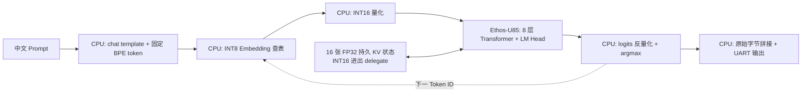

# 261111-MiniMind2-Small 在 Ethos-U85 上的部署与精度排查

# MiniMind2-Small 在 Ethos-U85 上的部署、精度排查与复现报告

> 2026-11-13 补记。本文早期章节保留当时的精度基线和交付判断，最终 128-token 状态见第 14 节及 [阶段交付清单](Closeout.md)。

**日期：** 2026-11-11

**项目：** Arm ML Embedded Evaluation Kit

**平台：** Corstone-320 / MPS4 SSE-320，Cortex-M85 + Ethos-U85 Z1024（1024 MAC/cycle），512 KiB Dedicated SRAM

**框架：** ExecuTorch 1.5.1（PT2E A16W8 / Arm TOSA / Vela）

**数据口径：** 功能与精度数据来自 **FVP（functional `--fast`）**；FVP 与 FPGA 的推理结果此前已验证为逐 token 一致，因此精度实验全部在 FVP 完成。计时数据中 FVP 的 `invoke` 为功能仿真耗时，**不代表 FPGA 性能**。

---

## 1. 结论摘要

### 1.1 已交付

- WSL 内完整跑通 `HF checkpoint → Meta 格式 → PT2E A16W8 量化 → Arm TOSA → Vela(512 KiB) → PTE` 的导出链路，并保留全部中间产物与脚本。
- 工作区内 `source/app/use_case/minimind2_small/` 完成端侧部署：单/多 delegate、INT16 持久 KV cache、端侧 BPE 反解码、PMU/CPU 计时、零缓存探针、golden token 对比。
- **可用交付版本为 linear 量化变体**（softmax / RMSNorm / RoPE 留在 CPU 浮点，49 个 Ethos-U delegate）：FVP 上 prompt top-1 **32/32**、generation **16/16**，文本正确。
- 单 delegate 全量化版本（1 个 delegate，28.6 MB PTE）可正常运行（≈1.2 s/token @ functional FVP），但精度只有 **8–9/32**，尚未解决。

### 1.2 核心精度发现

1. **加法掩码的动态范围是真实缺陷**：`-10000` 掩码把整个 attention score 路径的 INT16 标度抬到 `0.3052`。Arm 后端把 `exp` 降为 TOSA `TABLE`，表用 513 个采样点覆盖整个 int16 码域（每 128 个码一个点），于是设备上 `exp` 的实际采样间距是 **39 个实数单位**，中间线性插值——`exp(-5)` 被算成 ≈0.87，而真值是 0.0067。改为 `-30` 掩码后标度降到 `0.000916`，表间距 ≈0.155。
2. **该缺陷不是板端误差的主因**：host top-1 从 24/32 提升到 25/32，板端仍是 8/32；并且板端 `position=1` 的 top-5 在 `-10000`、`-30`、histogram 三种量化下 **完全不变**（只有 logit 数值 11.648 → 11.490 → 11.413 的微动），说明剩余偏差与量化 scale 无关，是 NPU attention 多有效位位置上的**结构性差异**。
3. **linear 量化是当前唯一能复现 host 的方案**，已作为默认交付。

### 1.3 当前关键指标

| 项目 | linear 变体（交付） | 单 delegate 全量化（研究） |
| --- | --- | --- |
| PTE 大小 | 28,651,552 B | 28,611,968 B |
| Ethos-U delegate 数 | 49 | 1 |
| Prompt top-1（FVP vs host） | **32/32** | 8–9/32 |
| Generation 匹配 | **16/16** | 0/16 |
| 生成文本 | `我是一款基于深度学习的自然语言处理模型，能够理解和生成` | `您所相关的知识点是正确的，复杂性是通过语言和思维`（语义漂移） |
| 零缓存 position 1 | top1=2（host=2） | top1=1473（host=2） |
| NPU cycles（32 token prompt） | 2,172,512（≈67.9k/token） | ≈1.63M（≈51k/token，单委托） |
| functional FVP invoke | ≈16.8 s/token（CPU 回退多） | ≈1.2 s/token |

> 注：单 delegate 的 NPU cycle 数反而更低，因为 softmax/RMSNorm/RoPE 都在 NPU；linear 变体这些算子回到 CPU，但功能正确。FPGA 性能需在最终选定版本后用 TA ON 实测。

---

## 2. 模型与部署方案

### 2.1 模型

`jingyaogong/MiniMind2-Small`（HuggingFace，固定 revision，见 `provenance.json`）。

| 参数 | 值 |
| --- | --- |
| `dim` | 512 |
| `n_layers` | 8 |
| `n_heads` / `n_kv_heads` | 8 / 2（GQA，`n_rep=4`） |
| `head_dim` | 64 |
| `hidden_dim` | 1408 |
| `vocab_size` | 6400 |
| 上下文 | 64 token（静态 KV cache） |
| `norm_eps` / `rope_theta` | 1e-5 / 1e6 |
| RoPE | HF `rotate_half`（`use_hf_rope=true`） |
| 分词 | ByteLevel BPE（6400 token，端侧只做反解码） |

### 2.2 数据流



### 2.3 量化方案（A16W8）

| 数据/模块 | 方案 | 说明 |
| --- | --- | --- |
| Embedding 权重 | INT8，逐词条 scale | `embedding_quantize="8,0"` |
| Transformer 主体 | 权重 INT8 逐通道、激活 INT16 逐张量 | `ethosu_16a8w` |
| KV cache | 持久 FP32 状态，进出 delegate 时 INT16 | `model.quantize_kv_cache=False` |
| 激活最小值 | `epsilon = 2^-20` | 防止共享 qspec 把标度压到 ±8 |
| 观察器 | 默认 `HistogramObserver`；需要时整体换 `MinMaxObserver` | KV cache 需要 MinMax 覆盖离群值 |
| 非量化算子 | linear 变体：softmax/RMSNorm/RoPE 保持 float32 | `quantize_scope=linear` |

---

## 3. 环境与资源

### 3.1 WSL 工作目录

```
\\wsl.localhost\Ubuntu-24.04\home\mokuroo\documents\python\minimind\mlek_minimind2
```

- Python venv：`/home/mokuroo/.venvs/mlek-tinystories-et151`（ExecuTorch 1.5.1、torchao、Vela 4.x/5.x、flatbuffers）
- MLEK 根目录（从 WSL 访问）：`/mnt/c/Users/MC/Documents/mlek-client/ml-embedded-evaluation-kit`
- 工作目录内**不要**直接 `wsl -lc`；本机用 `wsl.exe -d Ubuntu-24.04 -e bash -lc '...'`

### 3.2 脚本索引（WSL）

| 脚本 | 作用 |
| --- | --- |
| `01_download_model.py` | 固定 revision 下载 HF 权重并记录 provenance |
| `02_convert_to_meta.py` | HF Llama → ExecuTorch Meta 格式，生成 `params.json` |
| `03_check_fp32.py` | FP32 HF vs ExecuTorch 精度对齐（`use_hf_rope` 修正后 max 4.5e-5） |
| `04_export_minimind2*.sh` | 导出入口（full / linear / softmax_cpu / softmax_scales / attnmask / hist） |
| `export_minimind2.py` | 导出器包装：量化补丁、SDPA 掩码、校准文本注入、TOSA 捕获 |
| `05_verify_pte.py` | PTE 结构检查 |
| `06_validate_delegate_io.py` | delegate 参数与 Vela 描述符逐项校验（含 6D 形状适配） |
| `07_host_reference.py` | host 量化 PT2 贪心参考（`--max-new-tokens 16`） |
| `07_host_reference_nozero.py` | 同上，但保留校准 KV cache（诊断用） |
| `08_compare_quantized.py` | host 量化 vs HF FP32 逐位置对比（logits/top-1） |
| `09_compile_512k*.py` | 用 512 KiB cache 配置重编译 TOSA 为 Vela payload |
| `10_repack_pte*.py` | 把新 payload 写回 PTE（单 delegate） |
| `11/12/13_*` | terminal transpose / mask terminal 变体 |
| `14_cache_offsets.py` | 打印 PTE 中 `(1,2,64,64)` 张量的分配信息 |
| `15_lower_quantized.py` | 从 `quantized.pt2` 单独重跑 lowering 并捕获 TOSA（避免重导出） |
| `diagnose_*.py` | quant/output/cache/rope/gqa/mask/nomask/weakmask 等只读诊断 |
| `dump_host_cache.py`、`dump_host_precision.py` | host KV cache / 精度导出 |
| `generate_minimind_reference*.py` | 由 host reference 生成 `MiniMindReference.hpp` |
| `render_calibration.py` | 渲染官方 chat template 校准文本（含 `@@END@@` 哨兵） |
| `export_minimind_tokenizer.py` | 导出 6400 个 token 的原始字节表 |

### 3.3 工作区资源

```
resources_downloaded/minimind2_small/
  minimind2_small_u85_1024_ctx64_w8a16_embedding8_linear.pte   ← 当前默认交付
  minimind2_small_u85_1024_ctx64_w8a16_embedding8_attnmask_512k.pte
  minimind2_small_u85_1024_ctx64_w8a16_embedding8_hist.pte
  minimind2_small_u85_1024_ctx64_w8a16_embedding8_softmax_cpu.pte
  minimind2_small_u85_1024_ctx64_w8a16_embedding8_softmax_scales.pte
  minimind2_small_u85_1024_ctx64_w8a16_embedding8_dedicated*.pte
  tokenizer_bytes.bin  params.json  provenance.json
  host_reference*.json  fp32_reference.json  quantized_vs_fp32*.json
  export_report*.json  pte_report*.json  vela_summary*.csv
  REPORT.md（英文版排查记录）
```

### 3.4 FVP 运行方式

```powershell
# 构建（FVP）
powershell -NoProfile -ExecutionPolicy Bypass `
  -File "source/app/use_case/minimind2_small/tools/build_test.ps1"

# 启动 FVP（raw UART，不启用 telnet 协商）
powershell -NoProfile -ExecutionPolicy Bypass `
  -File "source/app/use_case/minimind2_small/tools/run_fvp_test.ps1"
```

UART 通过 **TCP 127.0.0.1:5000 原样捕获**（`mps4_board.telnetterminal0.start_telnet=0`、`uart0.out_file=-`）：

```bash
python build/minimind2_small/capture_uart.py build/minimind2_small/fvp_uart_xxx.log
```

> FVP 进程要显式结束后再重跑；否则残留进程会占用 5000 端口，抓到的是上一次的会话。

---

## 4. 完整复现流程

### 4.1 一次性准备

```sh
cd /home/mokuroo/documents/python/minimind/mlek_minimind2
source /home/mokuroo/.venvs/mlek-tinystories-et151/bin/activate

python 01_download_model.py --output hf
python 02_convert_to_meta.py --hf-dir hf --output-dir model
python 03_check_fp32.py --hf-dir hf \
  --checkpoint model/minimind2_small_meta.pt \
  --params model/params.json --output-dir report
python export_minimind_tokenizer.py --hf-dir hf \
  --output /mnt/c/.../resources_downloaded/minimind2_small/tokenizer_bytes.bin
```

FP32 对齐的判据：`max |logits| < 1e-4` 且 32 个位置 top-1 全部一致。**必须** `use_hf_rope=true`，否则 HF 的 `rotate_half` 与 Meta 的交错 RoPE 不一致，误差可达 19。

### 4.2 导出（以交付的 linear 变体为例）

```sh
MINIMIND_REPORT_DIR=$PWD/report_linear ./04_export_minimind2_linear.sh
```

关键 Hydra 参数（完整列表见 `04_export_minimind2.sh`）：

```
base.model_class=stories110m
quantization.pt2e_quantize=ethosu_16a8w
quantization.quantize_scope=linear|full
quantization.embedding_quantize="8,0"
quantization.use_hqq=False
backend.ethosu.enabled=True
backend.ethosu.target=ethos-u85-1024
backend.ethosu.system_config=Ethos_U85_SYS_DRAM_Mid
backend.ethosu.memory_mode=Dedicated_Sram
model.use_kv_cache=True
model.quantize_kv_cache=False
model.enable_dynamic_shape=False
export.max_seq_length=64
export.max_context_length=64
```

校准文本通过环境变量注入（Hydra 不接受非 ASCII）：

```sh
export MINIMIND_CALIBRATION_DATA="$(python render_calibration.py hf '请用一句话介绍你自己。')"
```

### 4.3 512 KiB cache 重编译与重打包（单 delegate 变体）

```sh
python 09_compile_512k_attnmask.py     # 用 512KB 配置重编译 compiled_input.tosa
python 10_repack_pte_attnmask.py       # 把 payload 写回 PTE
cp report_attnmask_512k/..._attnmask_512k.pte \
   /mnt/c/.../resources_downloaded/minimind2_small/
```

> Vela `Dedicated_Sram` 与 `Dedicated_Sram_512KB` 在本模型上产生**逐字节相同**的 payload（已比对 SHA），说明该模型的调度对 arena cache 大小不敏感；两种 PTE 都能在 512 KiB 配置的板端运行。

### 4.4 host 参考与头文件

```sh
python 07_host_reference.py --checkpoint report_linear/quantized.pt2 \
  --hf-dir hf --output report_linear/host_reference.json --max-new-tokens 16
python 08_compare_quantized.py --checkpoint report_linear/quantized.pt2 \
  --hf-dir hf --output report_linear/quantized_vs_fp32.json
python generate_minimind_reference_linear.py     # 写 MiniMindReference.hpp
```

### 4.5 固件构建与验证

```powershell
# 切换 PTE 时必须重新配置（MODEL_PATH 是 CMake cache 变量）
cmake -S . -B build/minimind2_small/test/fvp `
  -Dminimind2_small_MODEL_PATH="<绝对路径>.pte" `
  -Dminimind2_small_CACHE_RESET=ON
cmake --build build/minimind2_small/test/fvp --parallel 8
```

验收判据（linear 变体）：

```
MINIMIND_SMOKE matches=32 total=32 success=1
MINIMIND_GENERATION matches=16 count=16 success=1
MINIMIND_TEXT 我是一款基于深度学习的自然语言处理模型，能够理解和生成
MINIMIND_ZERO1 top1=2 repeat=2
```

---

## 5. 导出器关键补丁（`export_minimind2.py`）

所有补丁都是对 ExecuTorch 官方 LLM 导出路径的**运行时包装**，不修改 submodule。

### 5.1 校准文本注入

Hydra 会拒绝非 ASCII 字符串（`LexerNoViableAltException`），因此把 chat template 文本经环境变量传入，并包装 `LLMEdgeManager.pt2e_calibrate`：

```python
ORIGINAL_CALIBRATE = LLMEdgeManager.pt2e_calibrate

def calibrate_with_unicode_text(self, *args, **kwargs):
    text = os.environ.get("MINIMIND_CALIBRATION_DATA")
    if text:
        kwargs["calibration_data"] = text.removesuffix("@@END@@")
    return ORIGINAL_CALIBRATE(self, *args, **kwargs)

LLMEdgeManager.pt2e_calibrate = calibrate_with_unicode_text
```

### 5.2 激活最小标度

`get_symmetric_a16w8_quantization_config` 的 `epsilon` 默认 `2^-12`（±8），会把 MiniMind 的残差流（±35）截断。改为 `2^-20`：

```python
def a16w8_with_wider_range(*args, **kwargs):
    kwargs.setdefault("epsilon", 2 ** -20)
    return ORIGINAL_A16W8_CONFIG(*args, **kwargs)
```

> 注意不要设成 `2^-9`：RMSNorm 的 `mean + 1e-5` 会被量化成 0，`rsqrt(0)=inf`。

### 5.3 显式因果掩码（当前版本：`-30`）

原生 bool SDPA 掩码在 TOSA 中不可靠，改为手工 `QK^T → +mask → softmax → context`：

```python
def manual_masked_sdpa(self, input_pos, q, k, v, bsz, seqlen, mask):
    k = k.repeat_interleave(self.n_rep, dim=1)
    v = v.repeat_interleave(self.n_rep, dim=1)
    scale = 1.0 / math.sqrt(self.head_dim)
    scores = torch.matmul(q, k.transpose(-2, -1)) * scale
    additive = torch.where(
        mask,
        torch.zeros_like(mask, dtype=q.dtype),
        torch.full_like(mask, -30.0, dtype=q.dtype),   # 不是 -10000
    ).view(1, 1, 1, -1)
    scores = scores + additive
    probs = torch.softmax(scores, dim=-1)
    output = torch.matmul(probs, v)
    return output.transpose(1, 2).reshape(bsz, seqlen, self.dim)
```

选择 `-30` 的依据：标定中 logits 相对行最大值最多只展开约 14，掩码位置 `exp(-16)≈1e-7` 在 INT16 输出中为 0；同时 score 标度保持在 `1e-3` 量级。

### 5.4 观察器切换

```python
if os.environ.get("MINIMIND_MINMAX_OBSERVER", "1") != "1":
    print("COMPAT: keeping HistogramObserver for activations")
else:
    arm_quantizer.HistogramObserver = MinMaxObserver
```

`MinMaxObserver` 是为了让 KV cache 覆盖 chat prompt 的 K 离群值（max 8.34）；`HistogramObserver` 让其它激活的 scale 更紧，host 精度 25/32 → 27/32。

### 5.5 TOSA 捕获（注意陷阱）

```python
def capture_tosa(tosa_flatbuffer, compile_spec):
    target = REPORTS / "compiled_input.tosa"
    if not target.exists():          # ← 只在文件不存在时写
        target.write_bytes(tosa_flatbuffer)
    return ORIGINAL_COMPILE(tosa_flatbuffer, compile_spec)
```

**坑：** 同一 report 目录重复导出时不会覆盖旧 TOSA，导致 512 KiB 编译用的是上一版图（payload SHA 完全一样却没人发现）。排查时用 `cmp` 校验新旧 TOSA，或先删除 `compiled_input.tosa`。多 delegate 变体只会捕获**第一个** delegate 的 TOSA。

---

## 6. 工作区 use case

### 6.1 目录

```
source/app/use_case/minimind2_small/
  usecase.cmake
  src/MainLoop.cc             # prompt → generation → 解码 → 零缓存探针
  src/MiniMindRuntime.{hpp,cc}# EtModel 封装、INT32/INT64 输入、top-k、计时
  src/MiniMindReference.hpp   # 由 host reference 生成的 golden token
  src/MiniMindTokenDecoder.{hpp,cc}
  src/ModelData.cc.in         # .incbin PTE 到 nn_model 段
  src/TokenizerData.cc.in     # .incbin tokenizer 到 minimind_tokenizer 段
  tools/build_test.ps1        # FVP/FPGA 构建
  tools/run_fvp_test.ps1      # FVP 启动（raw UART）
  docs/                       # 本报告
```

### 6.2 `usecase.cmake` 要点

| 配置 | 值/作用 |
| --- | --- |
| 平台约束 | 必须 mps4 / sse-320 / U85 / Z1024 / Dedicated_Sram |
| 最小 NPU cache | `ETHOS_U_NPU_CACHE_SIZE >= 524288` |
| `ACTIVATION_BUF_SZ` | `0x00180000`（method pool，位于 DDR） |
| DDR 布局 | PTE @ `0x70000000`，method pool 紧随其后，临时池 @ `0x73E00000`（2 MiB） |
| 链接脚本 | 运行时把 DDR 从 32 MiB 扩到 64 MiB，并插入 `*(minimind_tokenizer)` 段 |
| PTE 校验 | configure 阶段调用 `mlek_tools.validation.pte_validator` |
| 可移植算子 | `generate_pte_ops_lib` + 过滤 `native_dropout/rand/randn`（缺 `std::random_device`） |
| `minimind2_small_CACHE_RESET` | 默认 ON；OFF 时跳过启动时的 KV 清零（诊断变体用） |

### 6.3 KV cache 偏移

- 单 delegate：`524288 + i*32768`（16 × 32 KiB FP32 持久状态），planned buffer 1,095,680。
- linear 变体：`917504 + i*32768`（planned buffer 1,467,392）。
- 偏移对应的**物理顺序**与 host 侧 `layers.N.attention.kv_cache.*` 的顺序不同（板端是逆序 `[v7,k7,…,v0,k0]`），但 16 块集合一致，清零逻辑不受影响；`DumpCaches` 的标签因此会错配，仅影响日志可读性。

---

## 7. 排查时间线

| 阶段 | 内容 | 结论 |
| --- | --- | --- |
| 1 | 初次部署、PMU/端侧解码 | e2e 计时为 0（`CPU_PROFILE_ENABLED` 未开）；补上端侧反解码 |
| 2 | FP32 链路核对 | HF/Meta RoPE 不一致，`use_hf_rope=true` 后 max 4.5e-5 |
| 3 | host 量化对照 | full A16W8 host 24–27/32；板端仅 9–10/32 |
| 4 | 只读排查（cache/RoPE/GQA/mask） | cache 与 RoPE 正确；mask 变体无法复现板端 |
| 5 | softmax 量化（`sub/exp` 上 CPU） | 9 delegate，host 文本正确但 top-1 只有 23/32 |
| 6 | `amax` 独立 qspec | 板端 3/32、zero1=1876，**更差，放弃** |
| 7 | 掩码动态范围 | 定位 `-10000` → 标度 0.305 → exp 表间距 39；改 `-30` 后 host 25/32，板端 8/32 |
| 8 | 乘法掩码尝试 | SELECT dtype 冲突 + qspec 污染，host 20/32，放弃 |
| 9 | HistogramObserver | host 27/32，板端 9/32；KV scale 不变 |
| 10 | softmax-CPU bisect | 变体 delegate 边界 dtype 不匹配，无法上板 |
| 11 | linear 交付 | FVP 32/32、16/16、文本正确 |

---

## 8. 问题清单（现象 → 根因 → 处理）

### Q1. e2e / invoke 计时为 0
- **现象**：`MINIMIND_TIME` 中 `invoke_*`、`e2e_*` 全 0。
- **根因**：`timer_mps4.c` 只在 `CPU_PROFILE_ENABLED` 下注册 `"CPU TOTAL"` PMU 计数器。
- **处理**：构建加 `-DCPU_PROFILE_ENABLED=ON`；时钟 `cpu_hz=50000000` 本身正确。

### Q2. 没有端侧解码，看不到输出
- **处理**：导出 6400 个 token 的原始字节表（`tokenizer_bytes.bin`，56,446 B），端侧把所有生成 token 的原始字节拼接后以 UTF-8 输出，不做 BPE 编码。

### Q3. `CPU_PROFILE_ENABLED=ON` 后链接报 `open/close/read/write/lseek/fopen` 未定义
- **根因**：构建树里残留 ASR-ZH 打过补丁的 `EthosUBackend_Cortex_M.cpp.obj`（字符串含 `asr_zh_npu_call_*.bin`）。
- **处理**：删除该 object/库后从干净源码重建。

### Q4. HF 与 ExecuTorch FP32 logits 相差约 19
- **根因**：HF `LlamaRotaryEmbedding` 用 `rotate_half`，Meta 实现是交错 RoPE。
- **处理**：`params.json` 设 `"use_hf_rope": true`。

### Q5. A16W8 激活饱和（残差 ±35 被截到 ±8）
- **根因**：共享 qspec 使用 `epsilon=2^-12` 的最小标度。
- **处理**：`epsilon=2^-20`；`2^-9` 会让 RMSNorm 的 `mean+1e-5` 归零导致 `rsqrt(0)=inf`。

### Q6. HistogramObserver 低估 KV cache 范围
- **现象**：chat prompt 的 K 最大值 8.34 被裁掉。
- **根因**：KV cache 在校准中大部分为 0，histogram 按分位数截断。
- **处理**：默认 `MinMaxObserver`；需要 tighter scale 时用 `MINIMIND_MINMAX_OBSERVER=0`。

### Q7. 改了 `usecase.cmake` 的默认 PTE 但板端还是旧模型
- **根因**：`minimind2_small_MODEL_PATH` 是 CMake cache 变量，重新 configure 不会覆盖已有缓存。
- **处理**：删除 `build/minimind2_small/test/fvp`，或显式 `-Dminimind2_small_MODEL_PATH=...`。

### Q8. `-10000` 掩码导致 softmax 在 NPU 上失真（核心）
- **现象**：host OK、板端崩；`position=0` 正确、`position>=1` 起错；把 softmax 放回 CPU 后板端正常。
- **根因**：`-10000` 把 score 张量范围抬到 ±10000 → INT16 scale 0.3052；Arm 后端把 `exp` 降为 TOSA `TABLE`，表用 513 个点覆盖整个 int16 码域（每 128 码一个点），实际采样间距 39 个实数单位，硬件线性插值。
- **处理**：掩码改 `-30`（标度 0.000916，表间距 ≈0.155）。host 24→25/32，板端不变（见 Q11）。

### Q9. 乘法掩码方案的 SELECT dtype 错误
- **现象**：`TosaValueError: Expected matching dtypes but got torch.int16 and torch.float32`（`tosa.SELECT`）。
- **根因**：`torch.zeros_like(scores)` 分支在 lowering 后仍是 float32 常量（被 fuse 成公共 const），而另一分支已是 int16。
- **处理**：改用 `row_max - 20.0`（由 int16 张量参与运算产生）替代零常量；lowering 通过。

### Q10. 乘法掩码的 qspec 污染
- **现象**：改完后 `sub`/`where` 的输入标度仍是 0.305，host 掉到 20/32。
- **根因**：`scores` 同时喂给两个 select，PT2E 只插入一份 q/dq，第一个 select 的 ±10000 输出 qspec 被第二个 select 复用。
- **结论**：只要 `-10000` 出现在图里，score 路径的标度就一定被污染；乘法掩码方案因此放弃。

### Q11. `amax` 独立 qspec 失败
- **做法**：从 `SharedQspecQuantizer.targets` 中移除 `aten.amax.default`（92 → 91 个 target，单 delegate）。
- **结果**：板端 3/32、zero1=1876，比 full 更差。
- **结论**：放弃；问题不在 `amax` 与邻居共享标度。

### Q12. Vela 512 KiB 编译的 payload 与 exporter 内嵌 payload 完全相同
- **现象**：`old_payload_sha256 == new_payload_sha256`。
- **解释**：本模型调度对 arena cache 大小不敏感；重打包仍是必要的流程步骤，但不是精度问题的来源。

### Q13. `capture_tosa` 只在文件不存在时写盘
- **现象**：重复导出后 512 KiB 编译的 payload SHA 与上一版完全一致。
- **处理**：换 report 目录、删除旧 `compiled_input.tosa`，或用 `15_lower_quantized.py` 从 checkpoint 重新 lower 并抓取。
- **注意**：多 delegate 变体只捕获第一个 delegate 的 TOSA，不能直接用于重打包。

### Q14. 板端 `position>=1` 的误差与量化 scale 无关
- **现象**：`-10000`、`-30`、histogram 三种 PTE 下板端 `position=1` top-5 恒为 `[2409, 3441, 644, 773, 65]`，只有 logit 值微动；`position=0` 的 logit 在三种量化下稳定到 6e-5，而 host 会变化。
- **已排除**：KV cache（与 host 一致）、RoPE（缓存的 K 与 host 一致）、掩码（no-mask 77 / all-false 77 / identity 2 / slot0 82 / inverted 291 / tril+1、+2 28 / identity-RoPE 28 / 未归一化 85 / 注意力输出置零 291，均不能复现 2409）、GQA 展开顺序、初始校准 cache。
- **结论**：多有效位位置的 NPU attention 存在结构性差异，与量化噪声无关。

### Q15. softmax-CPU bisect 变体无法上板
- **现象**：`E [ExecuTorch: EthosUBackend.cpp:409] Ethos-U output 3 expansion factor 2 with element size 2 not supported`。
- **校验**：`06_validate_delegate_io.py` 报 `Delegate tensor 10: (1,8,1,1)/32 bytes != Vela (1,1,1,8,1,1)/16 bytes`，即边界 tensor ET 为 float32、Vela 为 int16。
- **原因**：被排除量化的 `sub/exp` 在 delegate 边界留下 dtype 不一致。
- **状态**：未解决；bisect 因此中断。

### Q16. `kCacheOffsets` 与 host buffer 顺序不同
- **现象**：按偏移 dump 的 cache 值与 host 的 `layers.N.*` 对不上。
- **原因**：板端布局是逆序 `[v7,k7,…,v0,k0]`，16 块集合相同。
- **影响**：清零正确；`DumpCaches` 标签错配，仅日志可读性问题。

---

## 9. 精度数据

### 9.1 softmax 链路 qparams（`report_attnmask/quantized.pt2`）

| 张量 | `-10000` 掩码 | `-30` 掩码 |
| --- | --- | --- |
| `where` 输出（掩码常量） | 0.3052 | 0.000916 |
| `amax` 输入 | 0.3052 | 0.000916 |
| `sub` 输入 | 0.3052 | 0.000916 |
| `exp` 输入 | 0.3054 | 0.00117–0.00127 |
| `exp` 输出（sum 输入） | 0.00885 | 0.00885 |
| KV cache k / v | 0.000254 / 3.83e-5 | 0.000254 / 3.83e-5 |

由 `exp` 输入标度反推，标定中 score 相对行最大值的展开约 11–14。

### 9.2 host top-1 vs FP32（32 个 prompt 位置）

| 变体 | host top-1 | 板端 top-1 |
| --- | --- | --- |
| FP32（HF） | 32/32（基准） | — |
| full A16W8，`-10000` | 24/32 | 9–10/32 |
| `amax` 独立 qspec | 24/32 | 3/32 |
| 乘法掩码 | 20/32 | — |
| `-30` 掩码 | 25/32 | 8/32 |
| `-30` + `HistogramObserver` | **27/32** | 9/32 |
| linear（softmax/RMSNorm/RoPE float） | 32/32 | **32/32** |

这里的“Histogram 版”指 PT2E 激活校准使用 `HistogramObserver`，同时 attention mask 使用 `-30`；模型结构和权重量化方式不变。它是较早的一组校准实验。后来发现 histogram 会裁掉校准样本中很少出现、但真实 prompt 会出现的 KV cache K 离群值，因此最终导出改用 `MinMaxObserver`；不要把“Histogram 版”理解成权重直方图量化或新的模型版本。

### 9.3 host top-1 间距分布（`-30` 图）

32 个位置的 top1−top2 间距：`[2.131, 0.035, 0.721, 0.791, 0.457, 1.979, 0.429, 1.332, 0.316, 4.053, 0.198, 7.357, 0.811, 1.477, 0.052, 0.168, 0.449, 0.132, 2.078, 0.202, 1.033, 2.671, 0.108, 0.821, 1.266, 5.46, 0.315, 0.363, 1.209, 0.122, 3.595, 1.856]`

- `< 0.05`：1 个；`< 0.1`：2 个；`< 0.3`：8 个；`< 1.0`：18 个。
- 板端 `position=0` 的 logit 与 host 相差约 0.04；`position=1` 相差约 1.0。
- 说明模型本身有大量近 tie 位置，对定点噪声极其敏感。

---

## 10. 当前交付与工作区状态

- 默认 PTE：`minimind2_small_u85_1024_ctx64_w8a16_embedding8_linear.pte`
- `MainLoop.cc`：`kCacheOffsets = 917504..1409024`，`MINIMIND_NO_CACHE_RESET` 条件编译（`minimind2_small_CACHE_RESET` 默认 ON）
- `MiniMindReference.hpp`：由 `host_reference_linear.json` 生成
- 其它变体 PTE 均保留在 `resources_downloaded/minimind2_small/`，切回时同步修改 `MODEL_PATH`、`kCacheOffsets` 和 golden header。

### 10.1 各变体文件与结构

| 变体 | 文件后缀 | 大小 (B) | delegate | planned buffer | cache 偏移 |
| --- | --- | --- | --- | --- | --- |
| full `-10000` | `_dedicated` | 28,610,032 | 1 | 1,095,680 | 524288..1015808 |
| full `-10000` 512k | `_dedicated_512k` | 28,610,048 | 1 | 1,095,680 | 同上 |
| terminal | `_dedicated_512k_terminal` | 28,610,688 | 1 | — | — |
| amax 独立 | `_softmax_scales` | 28,597,600 | 1 | 1,095,680 | 524288..1015808 |
| `-30` 掩码 | `_attnmask_512k` | 28,611,968 | 1 | 1,095,680 | 524288..1015808 |
| `-30` + Histogram | `_hist` | 28,611,936 | 1 | 1,095,680 | 524288..1015808 |
| softmax CPU | `_softmax_cpu` | 28,617,920 | 9 | 1,086,976 | 未标定 |
| linear | `_linear` | 28,651,552 | 49 | 1,467,392 | 917504..1409024 |

---

## 11. 未解决问题与下一步建议

### 11.1 单 delegate 精度（主线）

剩余误差已被收窄到"多有效位位置的 NPU attention 存在结构性差异"。建议按以下顺序推进：

1. **暴露 attention 概率为额外图输出**：在 `manual_masked_sdpa` 中把某一层的 `probs` 写入一个可变 buffer 或作为额外输出，端侧打印，与 host 同位置直接对比。这是唯一能判定"权重错"还是"V 读错"的手段。
2. **修复 softmax-CPU bisect 变体的边界 dtype**：让被排除量化的 `sub/exp` 边界也插入正确的 q/dq（或把该 tensor 显式 cast），使 9-delegate 变体能上板；用它把问题切到 softmax 或 RMSNorm/RoPE 一侧。
3. 若确认是 Vela int16 定点链路精度不足，可评估：
   - 更紧的激活 scale（按张量裁剪离群值，而不是全局 Histogram）；
   - 把 `exp` 的输出标度从 `0.00885` 提高（当前 sum 输入只有 ~113 个码/单位，约 7 bit）；
   - 或接受 linear 变体作为最终交付。

### 11.2 交付向

- 在 FPGA 上用 TA ON 实测 linear 变体的性能（当前只有 functional FVP 数据）。
- 评估 49 delegate 的调度开销是否可接受；若不可接受，再回到单 delegate。

### 11.3 工程化

- 把 `09/10/11` 等脚本参数化（报告目录、PTE 名），避免每次 sed 生成变体。
- `DumpCaches` 的偏移标签改为运行时从板端探测，或直接按集合清零并只打印集合指纹。
- 修复 `capture_tosa` 的覆盖策略（多 delegate 时按 delegate 序号命名）。

---

## 12. 附录

### 12.1 关键日志位置（工作区）

```
build/minimind2_small/fvp_uart_attnmask.log     # -30 掩码板端
build/minimind2_small/fvp_uart_hist.log         # histogram 板端
build/minimind2_small/fvp_uart_linear3.log      # linear 板端（交付）
build/minimind2_small/fvp_uart_bisect.log       # softmax-CPU 边界错误
build/minimind2_small/fvp_uart_repeat.log       # 可重复性探针
build/minimind2_small/fvp_uart_amax.log         # amax 独立 scale
```

### 12.2 常用诊断命令

```sh
# softmax 链路 qparams
python diagnose_scales.py report_attnmask/quantized.pt2

# TOSA 算子清单（确认 TABLE / SELECT / REDUCE_* 是否进入 Vela）
python dump_tosa_ops.py report_attnmask/compiled_input.tosa

# host 零缓存探针
python diagnose_cache.py

# delegate I/O 形状/dtype 校验
python 06_validate_delegate_io.py <pte>
```

### 12.3 FVP 环境变量要点

- `-C mps4_board.ethosu.num_macs=1024`
- `-C mps4_board.ethosu.extra_args=--fast`
- `-C mps4_board.telnetterminal0.mode=raw / start_port=5000 / start_telnet=0`
- `-C mps4_board.uart0.out_file=-`
- `-C mps4_board.visualisation.disable-visualisation=1`

### 12.4 版权

本报告与相关脚本遵循 Apache-2.0；模型权重来自 `jingyaogong/MiniMind2-Small`，遵循其原始许可。

---

## 13. RMSNorm rsqrt 分段输入映射（2026-11-12）

### 13.1 本轮做法

为保留一个完整的 Ethos-U delegate，在 17 个 RMSNorm `rsqrt` TABLE 前加入 INT16 分段线性输入映射。映射把低值区压得更密，并把高值区延伸到各节点可表示的上界；随后仍由原 TOSA TABLE 和输出量化完成倒数平方根。当前候选使用 `alpha=0.85`。

相关实现和产物位于指定 WSL 工程：

```text
/home/mokuroo/documents/python/minimind/mlek_minimind2/report_rmsnorm_reclaim/
  30_warp_tosa_rsqrt.py
  31_exact_warp_reference.py
  32_compare_inputwarp_fp32.py
  33_sweep_inputwarp_alpha.py
  lut_fit/warped_input.tosa
  lut_fit/minimind2_small_ctx64_w8a16_warp_rsqrt_512k.pte
```

`TOSA RESCALE` 的主机模拟使用 NumPy ties-to-even 近似 `SINGLE_ROUND`；FP32 对照和参数筛选适合判断趋势，不能代替 Vela/FVP 最终验证。

### 13.2 主机 FP32 对照

每个用例比较 prompt top-1 和 8 个贪心生成 token。BOS-only 用例从单个 BOS token 开始。

| 分段点 alpha | 标准中文 | 短中文 | 英文 | BOS-only |
|---|---:|---:|---:|---:|
| PT2 A16W8 基线 | 25/32，4/8 | 20/25，2/8 | 31/35，3/8 | 1/1，8/8 |
| 0.75 | 27/32，4/8 | 19/25，2/8 | 28/35，3/8 | 1/1，8/8 |
| **0.85** | **26/32，4/8** | **19/25，8/8** | **30/35，3/8** | **1/1，8/8** |
| 0.95 | 23/32，4/8 | 18/25，8/8 | 29/35，3/8 | 1/1，8/8 |

每个单元依次为 prompt、generation。`alpha=0.85` 明显改善短中文生成，BOS 结果保持；标准中文只增 1 个 prompt 位置，英文 prompt 比 PT2 基线少 1 个。三个全局 alpha 都没有在各类输入上稳定超过基线。

### 13.3 Vela 与 PTE

- Vela：U85-1024、Dedicated SRAM 512 KiB；775 个 NPU op、0 个 CPU op；45 个 delegate 输入、17 个输出。
- Scratch：fast scratch 198,736 B，scratch 281,920 B。
- PTE：28,623,488 B，1 个 Ethos-U delegate，planned buffer 1,095,680 B；SHA256 `a9380989f59779c521776c6ff6823659407303ec82c28cfa281417d23ac03c9f`。
- FVP 确认加载上述 PTE，delegate call 为 `EthosUBackend`；KV cache 的 16 个偏移为 524,288 至 1,015,808，每块 32,768 B。

工作区内的候选文件为 `resources_downloaded/minimind2_small/minimind2_small_u85_1024_ctx64_w8a16_embedding8_warp_rsqrt_512k.pte`。它保留作实验产物；默认模型仍为 linear 变体。

### 13.4 FVP 实测

本轮完整跑完了 32 个 prompt 位置、16 个生成 token，以及两次相同状态的零缓存 position-1 探针：

- 按候选 PT2 主机参考：prompt **29/32**，generation **6/16**。
- 按当前 linear 基线参考重新比较：prompt **28/32**，generation **4/16**。
- 板端生成 token：`397, 1157, 1805, 3760, 2835, 269, 4833, 954, 4725, 270, 451, 2212, 2148, 812, 341, 991`。
- 端侧 ByteLevel 解码成功：`我是一款基于人工智能的聊天机器人，可以回答各种问题、提供`。
- 零缓存探针两次均为 top-1 `646`，重复性一致；position-1 top-5 为 `646, 2, 85, 269, 315`。
- 计时钩子正常输出。FVP `--fast` 的 `prompt_sum` E2E 为 40.84 s/32 次，`decode_sum` 为 20.01 s/15 次；NPU 计数每次约 57,059 cycles。此数据用于确认钩子与阶段计时可用，不代表 FPGA 性能。

诊断版曾在 `RunInference` 后增加临时日志；打点确认后，输出读取和 6,400 个 logits 扫描均完成，源码中的临时日志已移除。先前只显示部分 generation 的 FVP 记录不应直接判作模型停滞：本轮使用工程脚本运行至完整 generation 和零缓存探针后才结束。

### 13.5 当前结论与下一步

分段映射可以在结构上保留单一 NPU delegate，且 BOS-only 样本没有退化；但目前没有得到跨中文、英文和自回归生成都可靠的全局 `alpha`。FVP 的 token 结果也没有达到 linear 基线。因此本候选不设为默认模型。

本轮已将 `MiniMindReference.hpp` 重新生成为 `host_reference_linear.json` 对应的 golden，与 `usecase.cmake` 当前默认的 linear PTE 保持一致。候选 PTE 的主机参考仍保存在 WSL 的 `host_reference_warp_tosa.json`。

下一轮建议：

1. 检查各 RMSNorm 节点独立的输入范围和误差，尝试 per-node `alpha`，同时保留未参与拟合的中文、英文及 BOS holdout。
2. 确认 TOSA/Vela `SINGLE_ROUND` 的精确舍入，再用相同语义复算 host reference，减少主机模拟与板端的差异。
3. 只有主机 holdout 接近 linear 基线后，再重新生成 TOSA、Vela 512 KiB 编译及 FVP 完整回归。
4. 将此前 `mul`、`add+mul` 回收版本各自完整跑到 generation 与零缓存结尾，确认旧日志中的中断是否只是捕获时长不足。

---

### 13.6 版权

本节的 WSL 脚本和部署说明遵循 Apache-2.0；MiniMind2 权重遵循其来源仓库许可。

### 13.7 逐节点 alpha 查表：主机与 FVP

对 17 个 RMSNorm `rsqrt` 节点分别拟合输入映射参数；每个节点使用 282 个保留激活样本，总计 4,794 个样本。该版本 TOSA、Vela 和 PTE 均在规定的 WSL 工程目录内生成。

主机对 FP32 的 top-1 对照如下；每格依次是 prompt、8-token generation。主机 TOSA 模拟的 `SINGLE_ROUND` 使用 NumPy ties-to-even 近似，结果只用于筛选趋势。

| 用例 | PT2 A16W8 | per-node alpha |
|---|---:|---:|
| 标准中文 | 25/32，4/8 | 25/32，8/8 |
| 短中文 | 20/25，2/8 | 19/25，8/8 |
| 英文 | 31/35，3/8 | 29/35，3/8 |
| BOS-only | 1/1，8/8 | 1/1，8/8 |

逐节点表保住 BOS-only，并把两类中文测试的生成分数提高到 8/8；prompt 和英文仍有小幅回退。因此不能仅凭主机分数判定为通用精度修复。

TOSA 与部署产物：

- WSL TOSA：`report_rmsnorm_reclaim/lut_fit/per_node/warped_input_per_node.tosa`，27,314,488 B，SHA256 `39cf7a6fb5886022704daf32ec092c41a8916db825f9329cebb663cbeab3a3b9`。
- Vela：U85-1024、Dedicated SRAM 512 KiB、775 个 NPU op、0 个 CPU op；45 个输入、17 个输出；fast scratch 198,736 B，scratch 281,920 B。
- PTE：28,623,488 B；execution plan 中确认是 **1 个 Ethos-U delegate call、1 个 delegate payload**；planned buffer 1,095,680 B；SHA256 `9fed54162bc0957eded0466d79d0cccdb822d6f94aa5d031497737f26fe51b75`。
- 工作区候选：`resources_downloaded/minimind2_small/minimind2_small_u85_1024_ctx64_w8a16_embedding8_warp_rsqrt_per_node_512k.pte`。

同一份 per-node PTE 在干净（无临时诊断代码）的 FVP 固件上跑完 32 个 prompt 位置、16 个生成 token 和两次 zero-cache position-1 探针：

- prompt 对当前 linear golden：**28/32**；16 个生成 token：**16/16**。
- FVP 相对 linear golden 的 prompt 错位在位置 `10、12、19、26`。逐节点主机模拟与 FVP 的 top-1 只在位置 `1、17` 不同；这两处 FVP 分别输出 `736、2910`，与 FP32/linear 参考一致，主机模拟则输出 `28、1380`。
- 生成文本：`我是一款基于深度学习的自然语言处理模型，能够理解和生成`。
- zero-cache top-1 两次均为 `2`；top-5 为 `2, 269, 14, 646, 85`。
- `prompt_sum`：32 次 E2E 40.184 s，NPU 总计 36.518 ms；`decode_sum`：15 次 E2E 19.188 s，NPU 总计 17.118 ms。计时来自 FVP `--fast`，只证明计时路径可用，不代表 FPGA 性能。
- 完整 UART 日志：`build/logs/minimind_logs/minimind_u85_1024_warp_rsqrt_per_node_uart_dynamic.log`。

### 13.8 RMSNorm 算子逐步回收 FVP 对照

为按相同 prompt、16-token generation 和零缓存探针比较三种既有切分 PTE，先从 PTE allocation 信息确认三版的 16 个 FP32 KV 缓存都占用 `524288..1015808`，每块 32,768 B。随后在独立 FVP 配置中显式指定对应 PTE 与相同 offsets；默认模型配置未修改。

| 变体 | RMSNorm 切分 | delegate calls | prompt | generation | zero-cache | 生成文本表现 |
|---|---|---:|---:|---:|---|---|
| stage1 `mul_npu` | 最后的乘法回到 NPU，`add/rsqrt` 留 CPU | 18 | 27/32 | 4/16 | `2/2` | 偏题：聊天机器人 |
| stage2 `add_mul_npu` | `add(eps)+mul` 回到 NPU，`rsqrt` 留 CPU | 35 | 27/32 | 4/16 | `2/2` | 偏题：聊天机器人 |
| stage3 `rsqrt_only_cpu` | 仅 `rsqrt` 留 CPU | 18 | 27/32 | 4/16 | `2/2` | 偏题：聊天机器人 |
| per-node alpha | RMSNorm 全部在同一 NPU delegate | 1 | 28/32 | **16/16** | `2/2` | 连贯，见 13.7 |
| linear 对照 | softmax/RMSNorm/RoPE 保持 float | 49 | 32/32 | 16/16 | `2/2` | 当前精度基准 |

三份切分 PTE 已复制至工作区 `resources_downloaded/minimind2_small/`：`minimind2_rmsnorm_stage1_mul_npu.pte`（28,129,952 B）、`minimind2_rmsnorm_stage2_add_mul_npu.pte`（28,135,568 B）、`minimind2_rmsnorm_stage3_rsqrt_only_cpu.pte`（28,092,032 B）。

三个 CPU rsqrt 切分版的板端结果相同：单独回收 `mul` 或 `add+mul` 都没有改善 prompt/generation；`zero-cache` 一直稳定为 2，不能区分这些方案。逐节点查表的完整 NPU 版本才恢复了这条固定生成序列的 16/16。由此可见，“把 rsqrt 放 CPU”本身不足以恢复 MiniMind；量化 `mean+eps` 的输入范围/查表映射仍是关键候选因素。这个判断只适用于当前用例，不能据此断言所有错误都来自 RMSNorm。

阶段 FVP 日志：

- `build/logs/minimind_logs/minimind_stage1_mul_npu_fvp_uart.log`
- `build/logs/minimind_logs/minimind_stage2_add_mul_npu_fvp_uart.log`
- `build/logs/minimind_logs/minimind_stage3_rsqrt_only_cpu_fvp_uart.log`

### 13.9 当前状态与下一步

- 默认 PTE 仍为 linear 版本；`usecase.cmake`、`MainLoop.cc` 的默认模型和 golden 均未切换。
- per-node alpha 是目前唯一同时满足“单 delegate call”和固定 generation 16/16 的全 NPU 实验候选，但 prompt 仍只有 28/32，不作为默认交付。
- 三个逐步回收 CPU 变体都未恢复 MiniMind generation；继续只调整算子放置顺序的收益有限。
- TOSA `SINGLE_ROUND` 的精确整数舍入已在 13.10 核对；下一步应针对 4 个 FVP/linear prompt 分歧位置检查各 `rsqrt` 节点的输入 code、warp code、TABLE 输出和后续 logit，而不是继续盲调全局 alpha。
- 保留 BOS-only、短中文、英文和整段 FVP prompt/generation/zero-cache 作为 holdout。
- FPGA 性能测量和最终候选的 FPGA 回归尚未做；per-node 候选的 TA 固件已生成，见 13.11。此前记录的准确率和计时数字仍来自 FVP 功能验证。

### 13.10 TOSA `SINGLE_ROUND` 的精确舍入复核

此前 host 评分器使用 `numpy.rint`（ties-to-even）近似 32-bit RESCALE。按 [TOSA 1.0.1 Scaling Helpers](https://www.mlplatform.org/tosa/tosa_spec_1_0_1.html) 的 `apply_scale_32`，`SINGLE_ROUND` 参考计算为 64-bit `value * multiplier`，加上 `1 << (shift - 1)`，再做算术右移。已在 WSL 新建 `report_rmsnorm_reclaim/37_eval_per_node_alpha_tosa_rounding.py`，按该整数规则重跑 per-node host holdout。

结果与 ties-to-even 近似完全相同：标准中文 25/32、8/8；短中文 19/25、8/8；英文 29/35、3/8；BOS-only 1/1、8/8。因而当前分数和 FVP/host 两处 top-1 分歧不能只归因于 `SINGLE_ROUND` 的 rounding tie 处理。新结果写入 WSL `report_rmsnorm_reclaim/lut_fit/per_node_alpha_exact_fp32_compare.json`；PTE 未变化，也未重新编译。

### 13.11 FPGA Timing Adapter 固件

为测量 per-node alpha 单 delegate 候选的 FPGA 性能，新增 `tools/build_test.ps1 -TimingAdapter` 开关，并在独立目录构建 FPGA 固件。构建配置显式指定候选 PTE 和 16 个 KV cache offsets；没有改变 `usecase.cmake` 中的默认 linear PTE，也没有运行板端测试。

- PTE：`resources_downloaded/minimind2_small/minimind2_small_u85_1024_ctx64_w8a16_embedding8_warp_rsqrt_per_node_512k.pte`，SHA256 `9fed54162bc0957eded0466d79d0cccdb822d6f94aa5d031497737f26fe51b75`。
- 目标：MPS4 FPGA / SSE-320 / Ethos-U85 Z1024；Dedicated SRAM cache 512 KiB；TA 开启，配置 `ta_config_u85_sys_dram_mid`。
- FPGA TA 寄存器基址：SRAM `0x51102000`，EXT `0x51102400`；UART0 `0x59303000`。
- 固件：`build/minimind2_small/test/fpga_ta_per_node_alpha/bin/mlek_minimind2_small.axf`，37,423,584 B；链接 map 在同目录 `bin/mlek_minimind2_small.map`。
- 可复现命令：

  ```powershell
  .\source\app\use_case\minimind2_small\tools\build_test.ps1 `
    -Target FPGA -TimingAdapter `
    -BuildDirectory 'build/minimind2_small/test/fpga_ta_per_node_alpha' `
    -ModelPath 'resources_downloaded/minimind2_small/minimind2_small_u85_1024_ctx64_w8a16_embedding8_warp_rsqrt_per_node_512k.pte' `
    -CacheOffsets '524288,557056,589824,622592,655360,688128,720896,753664,786432,819200,851968,884736,917504,950272,983040,1015808' `
    -Jobs 8
  ```

本次构建成功；目前只交付固件供 FPGA 性能测量，尚未测得 FPGA 上的 E2E、NPU cycles 或吞吐数据。

## 14. 128-token FPGA 实板排查与收尾

### 14.1 从 UART 超时定位到 KV 限幅

初版客户端跨函数读取 PowerShell 的 $Matches，握手成功后也会报 NullArray。修复后出现 Windows PowerShell 读取无 BOM UTF-8 中文提示符的乱码，提示符改为 ASCII，流式回复仍增量解码 UTF-8。板端采用单字节 ? / HELLO 重试握手，收到完整 token 行后发 ACCEPT，完成 prompt 推理后发 START。ACCEPT 可以区分输入已到板端与仍在等待上传。单线程板端在推理期间不会处理新请求。

「你好」25 token 在 ACCEPT 后等待 120 秒超时。COM5 原始抓取表明位置 0–3 持续完成，每次约 8.4 秒。位置 1 的 NPU TOTAL 为 9,814,821 cycles（按 50 MHz 为 196.296 ms），invoke 为 419,709,200 cycles，单步端到端为 421,271,924 cycles。按此速度处理 25 token 约 210 秒。源码检查发现原地 INT16 clamp 固定接受 [1,2,64,64] 和 stride 4096，ctx128 落入通用实现。改为按上下文校验 shape 和 stride 后，ctx128 实测 decode 434.2–434.7 ms/次。修复后的 NPU TOTAL 尚无单独采样，旧值不能与新 decode 拼成同轮占比。

### 14.2 性能与计时口径

ctx128 实板三轮 prompt 为 26、29、36 token，首段可见文本延迟为 11.92、13.16、16.31 秒，整轮为 15.47、30.81、43.01 秒。ACCEPT 仅 31–62 ms。ctx64 的独立实板对照为约 280.4 ms/decode，NPU 约 124.8 ms/decode。

旧版计时在跨 Infer 调用时直接相减 PMU 读数。Infer 会重置 PMU，导致无符号下溢。最终固件仅累加每次调用在同一 PMU 周期内的耗时，主机负责首字与整轮计时。最终计时帧已编译，待实板复测。用户已验证正常结束后退出客户端并重连，重连后可完成新一轮。

### 14.3 精度差异归属

同模板、贪心、128-token 预算的 11 条输入做了 FP32 / A16W8 PT2 / FPGA 对照。FP32 已会答偏和重复。Python 的无效代码和勇气故事反问在量化 PT2 就已出现，与 FPGA 文本一致。PT2 与 FPGA 停止原因 10/11 一致，问候、具体故事等仍有文本分叉。板端对照只有 UART 文本，尚无逐位置 token ID 或 logits，无法进一步把残差归到 TOSA 查表、Vela 或运行时。后续定位应让三方喂同一串 token，再查首个 top-1 分叉和 top-2 margin。

### 14.4 复现与证据

- 产物、哈希、构建入口、KV 布局与验收状态见 [阶段交付清单](Closeout.md)。
- FPGA 记录在仓库根目录下的 build/logs/minimind_logs/fpga/minimind_128tok_u85_1024_dedicated_512k.log 与 minimind_kv16n_u85_1024_dedicated_512k.log。
- 主机对照在 build/minimind2_small/ 下的 fp32_ctx128_comparison.jsonl 和 quantized_pt2_ctx128_comparison.jsonl。
