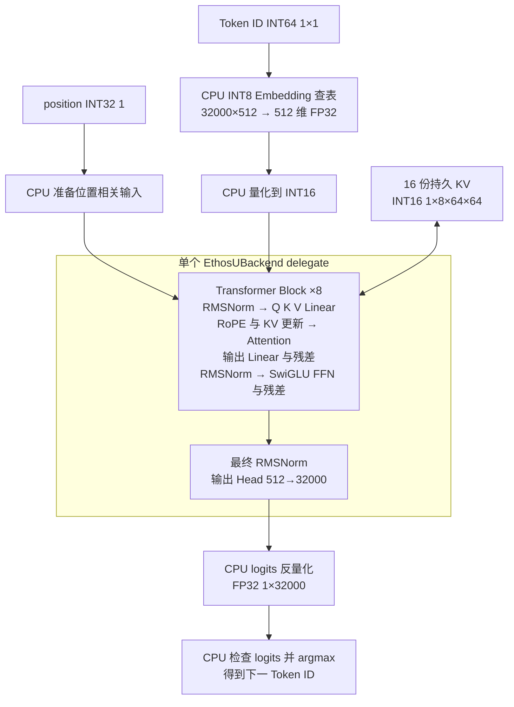
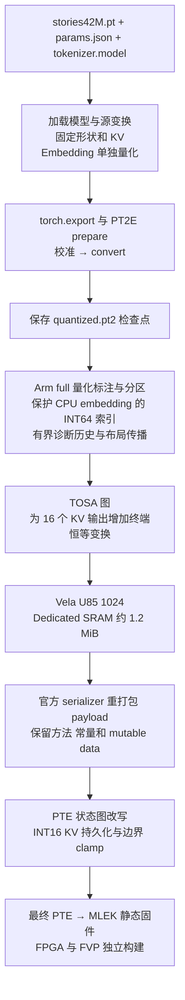
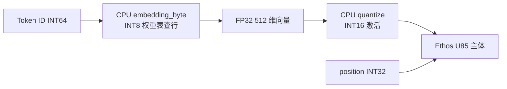
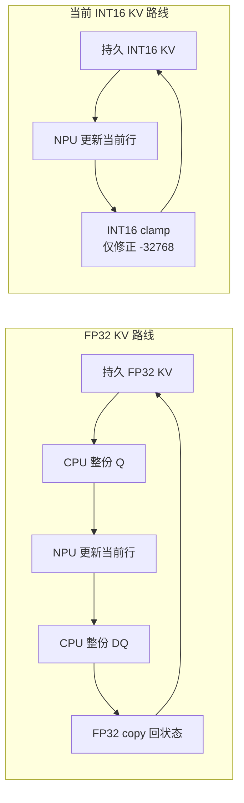
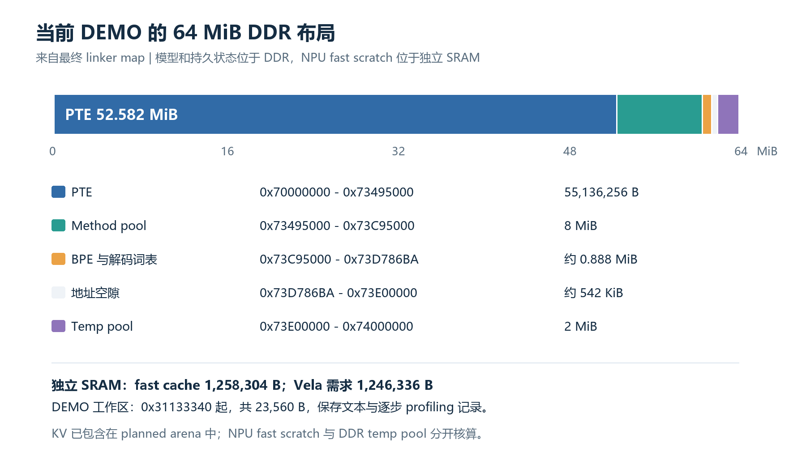
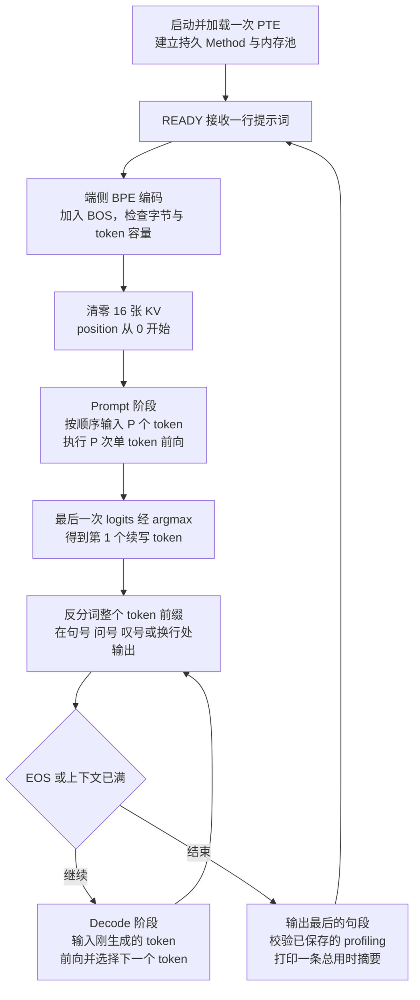
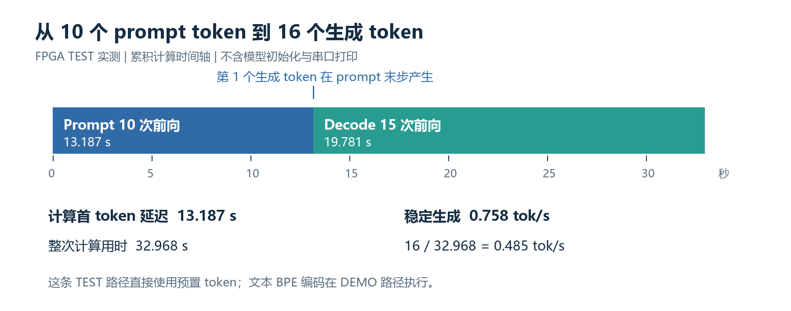
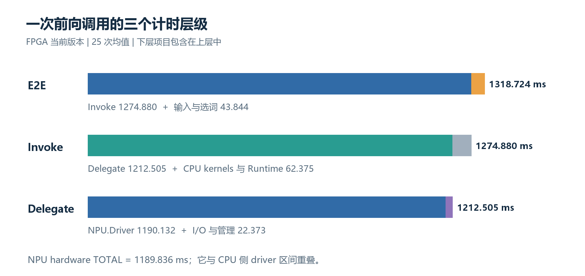
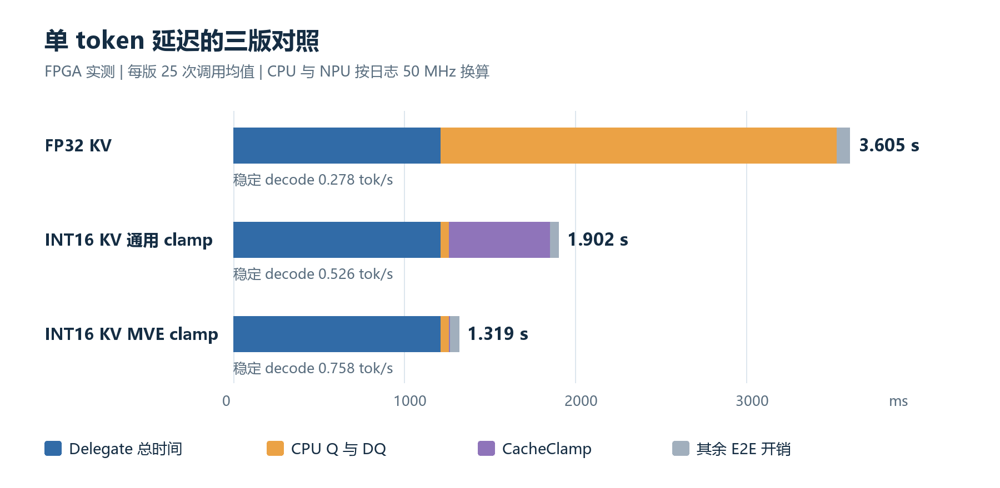

# TinyStories 42M 在 Ethos U85 上的量化导出与部署记录

整理日期：2026 年 11 月 10 日<br>
工程：Arm ML Embedded Evaluation Kit 26.09.0<br>
平台：MPS4 SSE-320 FPGA / Corstone-320 FVP，Cortex-M85，Ethos-U85 Z1024<br>
记录范围：模型引入、量化与图改写、PTE 修复、静态固件集成、板上优化、UART 故事演示。

本文回查了本次 TinyStories 对话的历次修改记录，并以实际脚本、生成报告、链接 map 和串口日志核对结论。历史调研附件提供背景；当前实现以工程产物为准。报告保留实验之间的继承关系，说明每项特殊处理解决了什么问题，以及收益落在哪个阶段。

## 当前结果

目前使用 **INT8 Embedding + W8A16 主体 + INT16 持久 KV cache**。Transformer 主计算由一个 Ethos-U delegate 执行，CPU 完成查表、边界转换、索引和选词。最终 PTE 为 **55,136,256 B，52.582 MiB**。

在最新 FPGA TEST 日志中，单 token E2E 均值为 **1318.724 ms**，稳定 decode 为 **0.758 tok/s**。经过 KV 状态格式优化和专用 clamp 优化，单步耗时从 **3604.781 ms** 降到 **1318.724 ms**；三版的 10 个 prompt top1 与 16 个生成 token 保持一致。当前 NPU hardware TOTAL 约占 E2E 的 **90.2%**。

FPGA 和 FVP 均已有独立 DEMO 构建。提示词编码和故事反分词在端侧执行，正文按句输出，结束后显示一个总用时摘要。当前 PTE 上下文为 64 token；10-token 提示词可续写最多 54 token。[S1-S4，L1-L3]

### 阅读索引

- [1 模型与当前产物](#1-模型与当前产物)
- [2 量化导出路线和版本演进](#2-量化导出路线和版本演进)
- [3 导出阶段的特殊处理](#3-导出阶段的特殊处理)
- [4 CPU 与 NPU 接口修复](#4-cpu-与-npu-接口修复)
- [5 INT16 KV 持久化和 MVE 优化](#5-int16-kv-持久化和-mve-优化)
- [6 权重存储与运行内存](#6-权重存储与运行内存)
- [7 故事生成的完整链路](#7-故事生成的完整链路)
- [8 prompt 与 decode 的宏观耗时](#8-prompt-与-decode-的宏观耗时)
- [9 单次推理的内部耗时](#9-单次推理的内部耗时)
- [10 优化收益与当前重点](#10-优化收益与当前重点)
- [11 数值和生成质量记录](#11-数值和生成质量记录)
- [12 TEST 与 DEMO 的计时和使用方式](#12-test-与-demo-的计时和使用方式)
- [13 关键问题的修复记录](#13-关键问题的修复记录)
- [14 复现入口与资料索引](#14-复现入口与资料索引)

## 1 模型与当前产物

### 1.1 网络结构

模型来自 `karpathy/tinyllamas` 的 `stories42M.pt`，采用 Llama 2 风格结构，在 TinyStories 数据上训练，用于英文故事续写。词表为 32,000，隐藏维度为 512，共 8 层 Transformer；每层 8 个 Query heads 和 8 个 KV heads，head dimension 为 64，FFN 中间维度为 1376。[S5，U1]



图 1　当前计算分工。RMSNorm、Attention、RoPE 主计算和 SwiGLU 均已进入 NPU 主体；图中的外部 KV 是状态关系，PTE 对外仍只有 token 和 position 两个输入。

### 1.2 参数量和接口

| 项目 | 当前值 |
|---|---|
| 独立参数 | 41,689,600，约 41.69M |
| 原 checkpoint 权重 | FP32，唯一存储 166,758,400 B |
| Embedding / Head | 原始浮点模型共享一张 `[32000,512]` 权重 |
| 对外输入 | token `INT64 [1,1]`；position `INT32 [1]` |
| 对外输出 | logits `FP32 [1,32000]` |
| 调用粒度 | batch 1，每次前向输入 1 token |
| 上下文 | 固定 64 token，包含 BOS、提示词和生成内容 |
| KV 状态 | 8 层 × K/V，共 16 张 `[1,8,64,64]` INT16 张量 |
| PTE 方法 | 8 个：1 个 forward，以及长度、层数、词表、KV 配置等查询方法 |
| delegate 边界 | 45 个输入、17 个输出；输出为 16 张 KV 和 1 张 INT16 logits |

对外输出的 FP32 logits 供 CPU 选词；delegate 内部 INT16 logits 经 PTE 中的反量化算子转换。多种数据类型分别承担索引、量化权重、激活和应用接口的职责。

### 1.3 精度配置

| 数据对象 | 表示 | 处理方式 |
|---|---|---|
| Token ID | INT64 | 词表行号，传给 CPU embedding kernel |
| position | INT32 | 当前序列位置 |
| Embedding 权重 | INT8 + 每词条 FP32 scale | 32,000 行，每行 512 元素 |
| Embedding 查表结果 | FP32 | 取出一行并反量化，再进入 INT16 边界 |
| Linear 权重 | INT8 | Vela 编码后交由 NPU 使用 |
| 主体激活和 NPU KV 边界 | INT16 | W8A16 路线；部分归约、累加使用更宽类型 |
| 持久 KV | INT16 | 与 NPU 输入输出格式一致，跨调用保存 |
| 应用 logits | FP32 | 扫描 32,000 项，检查有限值并选择最大项 |

W8A16 描述主体的权重和激活精度。Embedding 是单独配置的 INT8 权重路径；token 的 INT64 是索引位宽，与权重量化精度分别设置。

## 2 量化导出路线和版本演进

常规链路从 PyTorch 权重和结构开始，经静态导出、PT2E 量化、Arm 分区、TOSA lowering、Vela 编译，最后由 ExecuTorch 序列化为 PTE。当前实现围绕这条链路增加了源码兼容处理、Embedding 索引保护、TOSA KV 终端输出改写和 PTE 状态图变换。[S5-S9]



图 2　实际采用的导出与部署链路。KV 持久化改写位于 PTE 状态层，沿用已经验证的 NPU 命令流和权重。

### 2.1 从 linear 到 full

初版遵循官方 `quantize_scope=linear`，57 个 Linear 全部委托，形成 41 个 NPU 子图。Attention BMM、Softmax、RMSNorm、部分激活和状态处理仍在 CPU。随后先对真实首层 Block 做 W8A8 / W8A16 探针，再扩展为 `full` 全局量化，将主计算合并到一个 delegate。

`linear` 在本地实现中按 `torch.nn.Linear` 模块配置量化；`full` 使用全局配置覆盖后端可标注的计算。这里扩大的是量化与分区范围，RMSNorm、RoPE、Attention 和 SwiGLU 保留各自数学定义，由后端完成分解和 lowering。Softmax 使用因果掩码，并保持当前位置可见，每行存在有效 Attention 项。

早期分区报告按图节点统计，linear 版有 660 个委托节点和 805 个委托外节点，两种 full 候选的委托外节点均为 81 个。最终 PTE 的算子种类与动态调用数在第 1、9 节单独列出。

### 2.2 关键版本

| 版本 | 量化与状态 | PTE 字节数 | MiB | NPU 子图 | 关键结果 |
|---|---|---:|---:|---:|---|
| 初始基线 | W8A16 linear，FP32 Embedding / KV | 105,240,640 | 100.365 | 41 | 57 个 Linear 委托 |
| 全局 W8A8 对照 | full，INT8 Gather 表，FP32 KV | 55,991,408 | 53.398 | 1 | 固定 prompt 主机 top1 对齐 3/16 |
| 全局 W8A16 | full，INT16 Gather 表，FP32 KV | 72,440,352 | 69.085 | 1 | 同 prompt 主机 top1 对齐 16/16 |
| INT8 Embedding | CPU embedding_byte + W8A16 主体 | 56,185,040 | 53.582 | 1 | 相对上版节省 15.503 MiB |
| KV 终端输出修复 | Dedicated SRAM，17 个 Vela 输出 | 56,186,752 | 53.584 | 1 | 固件完成连续 NPU 调用 |
| INT16 KV 当前版 | 去掉 KV 浮点往返，保留整数 clamp | 55,136,256 | 52.582 | 1 | 当前 TEST / DEMO 使用 |

表内 W8A8 / W8A16 的 3/16、16/16 来自主机短序列对照；最终板端对齐记录见第 11 节。文件大小同时受权重表示、Embedding 路径、KV 初始化数据和 Vela 编码影响。

## 3 导出阶段的特殊处理

### 3.1 环境与序列化资源对齐

导出在 WSL Ubuntu 24.04 的独立环境 `/home/mokuroo/.venvs/mlek-tinystories-et151` 中完成。使用本地 ExecuTorch Python 源码和对应 wheel 的运行库；各实验目录保存 `environment.txt`、配置、量化检查点及日志。

首次流程处理了三项兼容问题：

1. 固定 Transformers `4.51.3`、PEFT `0.15.2`、Datasets `3.6.0`，对齐 `lm_eval 0.4.5` 的导入接口。
2. 显式加载官方 wheel 的 `kernels/quantized/libquantized_ops_aot_lib.so`，注册导出阶段所需的量化 out variants。
3. 从同一 checkout 的 `schema/` 复制 `program.fbs`、`scalar_type.fbs` 到源码序列化目录，并先完成 888 B ReLU PTE 的序列化预检。

这些处理使 Python 图转换、C++ 算子注册和 PTE schema 使用一致的版本来源。初期记录的 ExecuTorch checkout 为 `v1.5.1`，commit `3b60683923245cf472b7323426920e15623ba361`；关键源码 SHA256 另存于 `source_sha256.json`。[S5]

### 3.2 大图导出的有界处理

完整全局量化图在后端布局处理阶段耗时较长。`full_npu_compat.py` 采用进程内适配：`NodeSource` 保留当前来源信息，避免递归复制整段历史；`PropagateViewCopyPermutePass` 的布局传播最多执行一轮；保留逐项检查和最终 retrace，同时打印每个 pass 的开始与结束。

这样降低了诊断元数据与反复布局传播的处理成本。`quantized.pt2` 在 lowering 前保存，后续的检查、I/O 追踪和 payload 复编译都能从同一检查点继续。对 KV 输出问题做追踪时，两份检查点的图文本哈希一致，250 个状态项一致。[S6，S9]

### 3.3 校准配置的演进

初始 linear 路线使用 Wikitext，`calibration_limit=1`，配置序列长度 64。后续完成的 full smoke 与 INT8 Embedding 路线使用 `calibration_tasks=[]`，由导出器内置的 `Once upon a time` 校准输入驱动，仍配置长度 64；最终 protected 导出日志明确记录了这一输入。

这是当前实际量化参数的来源。独立质量评估随后使用 TinyStories validation 的 16 篇故事和 128 个计分 token。后续若扩展质量评估，应沿用固定检查点建立对照，再扩大提示词、文本和位置的校准覆盖。[S5-S7，Q1]

### 3.4 INT8 Embedding 的独立量化

全局 W8A16 的 Gather 表采用 INT16，单张 `[32000,512]` 表占 32,768,000 B。通过 `embedding_quantize="8,0"`、`use_hqq=False`，源变换把它改成逐词条 INT8 表：权重 16,384,000 B，32,000 个 FP32 scale 共 128,000 B。

对应算子为 CPU `quantized_decomposed::embedding_byte.dtype_out`，查表后产生 512 维 FP32 向量，再量化到 NPU 的 INT16 输入。该策略使 PTE 从 72,440,352 B 降到 56,185,040 B，单项节省 16,255,312 B。实板查表约 0.52 ms/次，因此它同时提供了较大的存储收益和较小的执行开销。

脚本中的 `base.model_class=stories110m` 用于复用该系列模型加载入口；实际加载 `stories42M.pt` 和本工程的 `params.json`，网络维度、层数和 FFN 均为 42M 版本。

## 4 CPU 与 NPU 接口修复

### 4.1 保护 CPU Embedding 的 INT64 索引

CPU `embedding_byte` kernel 按 `int64_t` 读取索引。最初 PTE 直接提供 INT32；把外部输入改成 INT64 后，Arm annotation pass 又插入 INT64→INT32 转换，导致同一断言继续出现。

最终在 TinyStories 导出进程内安装 `embedding_index_compat.py`：执行正常的 Arm placeholder 转换后，仅把 `embedding_byte` 的索引参数恢复到原始 INT64 placeholder，清理死节点并重编译图。position 和其他需要 INT32 的路径继续保留 INT32。



图 3　索引和数值精度分别处理。INT64 表示词表行号；INT8 表示 Embedding 权重内容。

构建时解析最终 PTE，核对 token 输入和 embedding 实际消费边的 dtype；最小 C++ embedding 用例也使用相同运行库执行，查表结果通过对照。检查对象覆盖最终产物和 runtime kernel，而不止源模型接口。[S8]

### 4.2 让 Vela 保留 16 个 KV 输出

输出拷贝报错曾显示：`65536 not divisible by 64000`。追踪表明，TOSA 与外层 delegate 声明 17 个输出，Vela 只保留了 logits 描述符：

| 输出对象 | dtype 与形状 | 单张大小 |
|---|---|---:|
| KV cache | INT16 `[1,8,64,64]` | 65,536 B |
| logits | INT16 `[1,32000]` | 64,000 B |

修复在 TOSA 的每个 KV 输出末端添加两次 permutation 为 `[0,1,3,2]` 的 transpose。两次交换恢复原始顺序，构成恒等变换，同时形成独立的终端输出，使 Vela 为 16 个 cache 和 1 个 logits 生成完整描述符。

重新编译该 TOSA 后，使用官方 `deserialize_pte_binary` / `serialize_pte_binary` 替换 delegate payload，保留原来的 8 个方法、常量、mutable data 和 named data。对外 forward 接口不变。

`validate_delegate_io.py` 随后检查输出数量、顺序、形状和元素宽度。新 Vela 结果为 **45 输入 / 17 输出**。修复后的 fast scratch 需求为 **1,246,336 B**，固件分配 **1,258,304 B**，两者随产物一起核对。[S9]

## 5 INT16 KV 持久化和 MVE 优化

### 5.1 优化对象是状态格式的往返

原路线已经保存历史 KV，逐 token 更新当前位置。额外开销来自固定大小 cache 的重复类型转换：16 张 FP32 cache 每步量化成 INT16，NPU 执行后又整份反量化并复制回 FP32 状态。



图 4　沿用量化后的 KV。每步涉及 16 × 32,768 = 524,288 个 cache 元素，整份浮点往返被整数状态复用替代。

### 5.2 PTE 状态图变换

`retain_int16_kv.py` 逐条匹配 cache 的 Q、DQ、copy 链，检查输入输出量化参数相同、状态消费者和内存分配关系。随后：

1. 将原 mutable FP32 初始值按该 cache 的量化参数转换成 INT16。
2. 将持久状态 dtype 改成 SHORT，delegate 输入输出都指向同一持久状态。
3. 移除 16 个 cache Q、16 个 cache DQ、16 个 FP32 copy。
4. 在 delegate 后保留 16 个原地整数 clamp。

状态别名与当前 backend 的 I/O 生命周期一致：执行前先把输入复制到 scratch，NPU 完成后再把输出复制回状态。PTE 中原有的状态初始化内容得到保留；DEMO 每轮独立请求另按模型元数据清零 KV 并从 position 0 开始。

| CPU kernel | FP32 KV 路线 | 当前 INT16 KV 路线 |
|---|---:|---:|
| Quantize | 36 | 20 |
| Dequantize | 19 | 3 |
| Embedding | 1 | 1 |
| Index | 10 | 10 |
| StateCopy | 16 | 0 |
| CacheClamp | 0 | 16 |
| 总调用数 | 82 | 50 |

NPU payload 的 SHA256 保持为 `143baca30e59753371dc48021a0fdfb22de5b7f800697402545ea8163fded097`。PTE 文件缩小 1,050,496 B，其中 mutable KV 数据由 2 MiB 减为 1 MiB；planned arena 保留原偏移，仍为 4,386,304 B。[S10]

### 5.3 保留整数边界行为

对每份 cache 的量化参数穷举全部 65,536 个 INT16 值，可得原状态往返：

```text
Q(DQ(q)) = clamp(q, -32767, 32767)

q = -32768 时，下一步应使用 -32767
其余 INT16 值保持原值
```

验证还执行了 64 个位置，共 2,880 组 delegate 输入比较，覆盖计划内存别名和每步的负边界；去掉 clamp 的负对照在后续输入上出现差异。板上三版的 26 条 token/top1 记录一致。[S10，L1-L3]

### 5.4 用专用循环替换通用 clamp

通用 `aten::clamp.out` 即使单文件 `-O2`，实板仍约 589.591 ms/次前向。专用路径只处理 SHORT、原地 `[1,8,64,64]`、上下界为 -32767 / 32767 的状态：

```cpp
for (size_t i = 0; i < count; ++i) {
    if (data[i] == INT16_MIN) {
        data[i] = -32767;
    }
}
```

构建在 TinyStories 专用目录生成 portable clamp 的局部副本，以 `-O2` 编译；其他输入继续走原实现。该文件单独加入 portable kernel 目标，避免被应用生成目录再次编译。最终 AXF 含 MVE 的 `vldrh.u16`、`vpt.i16`、`vstrht.16`，每轮处理 8 个 INT16 元素。

全值域、边界保护、重复执行和空范围检查通过。实板 clamp 降为 **6.038 ms/次前向**，约为原通用实现的 1/97.6。[S11，L2-L3]

## 6 权重存储与运行内存

### 6.1 PTE 为什么大于 42 MB

Embedding 与输出 Head 原本共享 16,384,000 个浮点参数。导出时两种用途采用不同表示：Embedding 需要按行访问，Head 进入 Vela 的权重重排和编码。原始共享关系在最终存储中变成两个表示。

初始 PTE 中，FP32 Embedding 占 62.50 MiB，Vela 编码权重占约 35.60 MiB，再加 KV 初始化及图数据形成 100.365 MiB。full W8A16 将 Gather 表变为 INT16，随后独立 INT8 Embedding 再次缩小。最终文件约分为：

| 内容 | 容量 |
|---|---:|
| 完整 NPU payload，含命令和编码权重 | 37,504,176 B，约 35.767 MiB |
| CPU Embedding 表与 scale | 16,512,000 B，约 15.747 MiB |
| mutable INT16 KV 初始值 | 1,048,576 B，1 MiB |
| 其余常量、接口和序列化数据 | 71,504 B，约 0.068 MiB |
| PTE 合计 | 55,136,256 B，52.582 MiB |

表中剩余项按文件总量减去前三项计算。当前 Embedding 和 Head 的 INT8 量化规则、scale、整数范围及布局分别生成；共享存储的后续研究需要同时统一数值编码与访问布局。[S7，S12]

### 6.2 当前 DEMO 的地址布局



图 5　DDR 采用 `[0x70000000,0x74000000)` 的 64 MiB 窗口。图中的地址区间右端均不包含在内。[S2，M1]

| 内存项目 | 预留容量 | 已有需求或峰值 | 所在位置 |
|---|---:|---:|---|
| PTE | 55,136,256 B | 文件实际大小 | DDR |
| Method pool | 8,388,608 B | 4,401,652 B | DDR |
| 其中 planned arena | 包含在 Method pool | 4,386,304 B | DDR |
| 其中 INT16 KV 状态 | 包含在 planned arena | 1,048,576 B | DDR |
| Temp pool | 2,097,152 B | 1,112,576 B | DDR |
| NPU fast cache | 1,258,304 B | Vela 需求 1,246,336 B | SRAM 0x31000000 |
| DEMO 编码表 | 594,923 B | 二进制表实际大小 | DDR |
| DEMO 解码表 | 336,586 B | 二进制表实际大小 | DDR |
| DEMO 文本与记录工作区 | 23,560 B | 静态分配 | SRAM 0x31133340 |

DEMO 静态 DDR 预算为 **66,553,555 / 67,108,864 B**，包含对齐余量，剩余约 542 KiB。8 MiB Method pool 是配置预留，4.40 MB 是已测使用量；KV 已在 arena 中核算。PTE 中的 KV 初始化数据和运行中的 KV 状态各自存在，文件占用与运行内存按不同区域记录。

后续压紧 planned arena、按高水位收紧 Method pool，可为长上下文释放空间。上下文长度每增加一个 token，当前结构的 INT16 KV 理论增加 16 KiB：ctx128 为 2 MiB，ctx256 为 4 MiB；Vela scratch 和其他工作区随新产物重新提取。

### 6.3 固件嵌入和板级地址处理

PTE 首次展开成约 339 MB 的十六进制 C++ 源文件时，ATFE 编译出现崩溃。当前 use case 采用 `.incbin` 把 PTE 原字节放入 `nn_model` 段，继续保留目标、内存模式和接口检查。

FPGA 使用 UART0 `0x59303000`；FVP 使用 `0x58203000`。两版使用独立构建目录。临时池显式放在 `0x73E00000`，显示关闭，构建和 linker 同时检查 PTE、Method pool、词表与临时池的边界。Dedicated 模式中，DDR temp pool 和独立 SRAM fast cache 各自承担对应的 NPU scratch 区域。

## 7 故事生成的完整链路



图 6　DEMO 的完整状态流。PC 在 FPGA 路径中收发串口文字，在 FVP 路径中通过 Raw TCP UART 收发文字。

### 7.1 Prompt 阶段是逐 token prefill

当前 PTE 每次消费一个 token。提示词有 P 个 token，就连续执行 P 次前向，每一步更新 KV。最后一次 prompt 调用的 logits 已经预测第一个续写 token，因此生成 G 个 token 的总前向次数为：

```text
前向次数 = P + G - 1
固定 TEST：P=10，G=16 → 25 次
当前完整上下文 DEMO：P=10，G=54 → 63 次
```

这条路径的 prefill 没有把整段 prompt 合并成一次多 token 矩阵推理。prompt 和后续 decode 使用同一个 forward：模型形状、权重读取、固定 64-token Attention 范围及 cache 边界保持一致。

### 7.2 两种 decode 的区别

| 名称 | 执行内容 | 当前典型量级 |
|---|---|---|
| LLM decode | 输入上一 token、更新 KV、计算 logits、选择下一 token | FPGA 每步约 1.319 s |
| 文本反分词 | Token ID 按词表转换为 UTF-8 文本，处理空格与 byte fallback | FPGA TEST 整段 110 B 约 0.212 ms |

模型生成耗时主要来自前者。按句显示的等待还包含句子积累：模型已经生成若干 token 时，终端可能仍在等待第一个句末标点。

### 7.3 板端 tokenizer 与请求隔离

BPE 编码表保存原始词片、float32 分数、查找顺序和 byte-token 映射。实现按得分合并相邻词片，保留 SentencePiece 的 dummy prefix、空格和 UTF-8 byte fallback；编码结果包含 BOS，不给提示词额外附加 EOS。

解码使用完整词表 surface 表。DEMO 在每次得到新 token 后重解整个已知前缀，按句末边界发送，结束时刷新剩余片段。这一实现与 64-token 容量对应，UTF-8 输出可跨 token 正确组合。

每轮请求清零生成契约列出的 16 个 KV 区间，保持模型权重、其他 arena 区域和 allocator 元数据。DEMO 还给 planned allocator 提供具有静态生命周期的 Span 存储，解决初始化函数局部 Span 容器退出后的生命周期问题。

## 8 prompt 与 decode 的宏观耗时

### 8.1 最新 FPGA TEST

本节使用 L3 中 10 个固定 prompt token 和 16 个生成 token。CPU 和 NPU 均按日志配置的 50 MHz 从原始 cycles 换算。各调用的输入填写、前向和选词位于 E2E 内；模型初始化、PMU 配置、串口日志和最后的文字反分词分开统计。



图 7　预置 token 的固定 TEST 计算时间。DEMO 的 BPE、KV reset、分句 UART 输出另有整轮总时间口径。

| 阶段 | 前向次数 | NPU TOTAL (s) | Invoke (s) | E2E (s) | 生成 token |
| --- | ---: | ---: | ---: | ---: | ---: |
| Prompt 逐 token 预填充 | 10 | 11.898139 | 12.748449 | 13.186892 | 1（末步） |
| 自回归 decode | 15 | 17.847771 | 19.123559 | 19.781216 | 15 |
| 计算累计 | 25 | 29.745910 | 31.872009 | 32.968108 | 16 |

第一个续写 token 在 13.187 s 的 prompt 末步产生。后 15 个 token 的计算速度为 `15 / 19.781216 = 0.758 tok/s`。计入提示词后，整次输出吞吐为 `16 / 32.968108 = 0.485 tok/s`。这两个指标分别描述稳定续写速度和该次短请求的平均输出速度。

### 8.2 文本处理和演示总时间

| 路径与工作 | 已记录结果 | 数据来源 |
|---|---:|---|
| FPGA TEST 整段反分词，110 B | 0.2117 ms | L3 |
| FVP 早期 32-token DEMO，提示词 BPE | 48.123 ms 仿真时间 | F1 |
| 同次 DEMO，KV 清零 | 21.135 ms 仿真时间 | F1 |
| 同次 DEMO，Prompt E2E，10 次前向 | 2,737.212 ms 仿真时间 | F1 |
| 同次 DEMO，自回归 decode E2E，31 次前向 | 8,485.405 ms 仿真时间 | F1 |
| 同次 DEMO，累计文本反分词 | 17.059 ms 仿真时间 | F1 |
| 最新 54-token DEMO 整轮 | 17,527.470 ms 仿真时间 | F2 |
| 同轮电脑实际等待 | 185.828 s | F2 |

FVP 的表内数字沿用其各自日志口径；它们与 FPGA 实测分别呈现。固定 FPGA 性能日志使用预置 token，表内的独立 BPE 耗时来自 FVP DEMO。当前 FVP 客户端用主机单调时钟显示实际等待时间，替换摘要中的仿真时长。

DEMO 的 `total_ms` 从提示词编码开始，到最后一次故事输出调用结束，覆盖编码、KV reset、全部前向、argmax、反分词、PMU 设置和故事 UART 写入。CPU SysTick 每轮重置一次，各 token 间仅重置 NPU PMU，保持整轮计时连续；摘要和 READY 的发送在该区间之后。

## 9 单次推理的内部耗时

### 9.1 计时层级



图 8　当前 FPGA 25 次调用均值。不同层级按包含关系排列。

```text
E2E = 输入填写与选词 + Invoke
Invoke = CPU kernels + Delegate.Total + Runtime.Other
Delegate.Total = InputCopy + NPU.Driver + OutputCopy + Delegate.Other
```

`NPU.Driver` 使用 CPU 时钟测量提交、执行和等待的完整区间；`NPU hardware TOTAL` 来自 NPU PMU，包含 NPU stall。两者重叠，分别呈现。`Delegate.Other` 是 delegate 内其余管理工作的残差；`Runtime.Other` 是 Invoke 内其余 runtime 工作的残差。

### 9.2 Prompt 和 decode 内部对照

下表均为每次前向的均值，单位 ms；prompt 样本 10 次，decode 样本 15 次。缩进项已经包含在所属父项中。[L3]

| 分项 | Prompt (ms) | Decode (ms) |
| --- | ---: | ---: |
| E2E | 1318.689 | 1318.748 |
| ↳ 输入填写、logits 检查与选词 | 43.844 | 43.844 |
| ↳ Invoke | 1274.845 | 1274.904 |
| 　↳ CPU Embedding | 0.519 | 0.523 |
| 　↳ CPU Quantize | 36.009 | 36.017 |
| 　↳ CPU Dequantize | 13.220 | 13.218 |
| 　↳ CPU Index | 1.435 | 1.433 |
| 　↳ CPU StateCopy | 0.000 | 0.000 |
| 　↳ CPU CacheClamp（MVE） | 6.036 | 6.039 |
| 　↳ Delegate.Total | 1212.478 | 1212.523 |
| 　　↳ 输入复制 | 10.021 | 10.039 |
| 　　↳ NPU.Driver | 1190.109 | 1190.147 |
| 　　↳ 输出复制 | 9.965 | 9.952 |
| 　　↳ Delegate.Other | 2.383 | 2.385 |
| 　↳ Runtime.Other | 5.149 | 5.150 |
| NPU hardware TOTAL（PMU，重叠计时） | 1189.814 | 1189.851 |

Prompt 与 decode 每步 E2E 分别为 1318.689、1318.748 ms，差异很小，符合两者共用静态单 token 图的执行方式。输入处理与选词约 43.844 ms，其中源码会逐项扫描 32,000 个 FP32 logits，执行有限值检查和 argmax。

当前 CPU 量化 20 次的对象为：17 组 512 元素的小型参数、1 组 512 元素的 Embedding 输出、2 组 32 元素的位置编码。反量化 3 次对应两张 RoPE 表及 logits。量化算子位于 PTE forward 内，由 CPU 执行，计入 Invoke；模型权重的离线量化则发生在导出阶段。

Delegate 每步执行 45 次输入复制，共 1,067,652 B；17 次输出复制，共 1,112,576 B，合计约 20 ms。它们包含 KV 边界数据传送，当前阶段占 E2E 约 1.5%。

### 9.3 Profiling 如何形成可信分项

第一次细分日志中 CPU native calls 全为零，约 2.34 s 被归入 `Runtime.Other`。原因是 selected operator 注册库缺少 `ET_EVENT_TRACER_ENABLED`，链接选中了空的 inline scope 实现。

修复为该库补齐与 runtime 一致的宏，并在最终 AXF 中检查真实回调。启动时执行真实 EventTracer scope 自检；每步按照 PTE 生成的 contract 核对算子次数和嵌套区间。FP32 KV 路线为 82 个 native calls，INT16 路线为 50 个。修复后，原版真正的 `Runtime.Other` 约为 7.53 ms，大量时间归入了 CPU Q/DQ。

这项修改完善了耗时归属。实际提速来自随后改变 KV 状态路径和 clamp 实现。当前使用 Debug 固件，专用 clamp 源文件单独 `-O2`；记录保留 profiling 回调开销这一构建条件。

## 10 优化收益与当前重点



图 9　每版 25 次 FPGA 调用均值。所有版本运行相同固定 prompt，并生成相同的 16-token NPU 序列。[L1-L3]

| 分项 | FP32 KV | INT16 KV + 通用 clamp | INT16 KV + MVE clamp |
| --- | ---: | ---: | ---: |
| CPU Quantize (ms) | 2112.601 | 35.977 | 36.014 |
| CPU Dequantize (ms) | 203.464 | 13.216 | 13.219 |
| CPU StateCopy (ms) | 22.655 | 0.000 | 0.000 |
| CPU CacheClamp (ms) | 0.000 | 589.591 | 6.038 |
| Delegate.Total (ms) | 1212.683 | 1212.510 | 1212.505 |
| NPU.Driver (ms，属于 Delegate.Total) | 1190.137 | 1190.143 | 1190.132 |
| Runtime.Other (ms) | 7.525 | 5.152 | 5.150 |
| 输入填写与选词 (ms) | 43.840 | 43.845 | 43.844 |
| 单步 E2E (ms) | 3604.781 | 1902.278 | 1318.724 |
| Prompt 累计 E2E (s) | 36.068 | 19.023 | 13.187 |
| Decode 累计 E2E (s) | 54.051 | 28.534 | 19.781 |
| 整轮计算 E2E (s) | 90.120 | 47.557 | 32.968 |
| 稳定 decode (tok/s) | 0.278 | 0.526 | 0.758 |

第一步将 KV 持久状态改为 INT16，去掉大块 Q/DQ 和浮点复制，单步由 3604.781 降至 1902.278 ms。第二步把通用 clamp 换成专用 MVE 路径，单步进一步降至 1318.724 ms。两步累计约 **2.73 倍**加速，稳定 decode 由 **0.278** 提升至 **0.758 tok/s**。

NPU.Driver 在三版中都约 1190 ms。最新 NPU hardware TOTAL 为 1189.836 ms，占 E2E 的 90.23%。由此可得，在 NPU 时间保持不变的条件下，即便其余 E2E 开销全部消除，吞吐也约为 `1000 / 1189.836 = 0.840 tok/s`。这一数值用于判断优化空间。

下一轮性能分析重点可转向 NPU 命令流、MAC 活跃度、AXI 读写等待和权重访问；CPU 侧可继续研究小型常量折叠、logits 扫描及 I/O 融合。真实瓶颈归属由对应 PMU 事件和新实测补充。

## 11 数值和生成质量记录

### 11.1 主机量化对照

W8A8 与 W8A16 的首层探针，分别得到平均相对 L2 0.21635、0.09621。随后固定 prompt 的整模主机 16 位置对照，W8A8 为 3/16，W8A16 为 16/16，后续路线选择 W8A16。INT8 Embedding 的同条自由生成和 16 个 teacher-forced 预测均与原 W8A16 一致。[S6-S7]

独立 TinyStories validation 对照采用 seed 20261104、16 篇故事，每篇 8 个提示 token 和 8 个计分 token，共 128 个目标 token：[Q1]

| 主机模型 | 每 token NLL | Perplexity | 对真实续写的 top1 准确率 |
|---|---:|---:|---:|
| FP32 | 1.400686 | 4.057984 | 61.71875% |
| W8A16 | 1.418500 | 4.130919 | 60.93750% |
| W8A16 + INT8 Embedding | 1.418604 | 4.131350 | 60.93750% |

INT8 Embedding 与原 W8A16 的 top1 为 128/128 一致；两者与 FP32 均为 126/128 一致。该记录刻画了独立 Embedding 量化的增量影响。

### 11.2 板端生成与优化等价性

| 对照 | 结果 |
|---|---|
| 板端 prompt top1 对主机 PT2 | 7/10 一致，position 5、6、7 分叉 |
| 板端 16 个生成 token 对主机 PT2 | 14/16 一致 |
| FP32 KV、INT16 通用 clamp、INT16 MVE 三版 | 10 个 prompt top1 与 16 个生成 token 全部一致 |
| FVP 32-token DEMO 的 A/B/A | 三轮均成功，两次 A 的 token 序列一致 |
| FVP 最新 54-token DEMO | 保留此前故事前缀，`reason=context_limit` |

主机 16-token 续写末尾为 `outside with her`，NPU 续写末尾为 `outside and explore`。当前确定存在的主机与 NPU 差异作为数值对齐的后续定位项保留；KV 和 clamp 两轮优化的行为一致性已经由同一组板端日志确认。

最新较长演示文本为：

> Once upon a time in a small village, there was a little girl named Lily. She loved to play outside and explore the world around her. One day, she was playing in the park when she saw a big, green frog. She was so excited and she wanted to show her friends. She ran

这里提示词 10 token、生成 54 token，总长 64，在 `She ran` 后触及上下文上限。故事可用任意合适的英文开头，例如 `A little cat found a magic key.`，`Once upon a time` 是示例前缀。

### 11.3 端侧文本和状态验证

解码器已与 SentencePiece 对照 33,013 条序列，覆盖完整词表、byte fallback 和 UTF-8 边界。板端编码加解码又对照了 1,512 条提示词，另检查非法 UTF-8、256 字节输入边界和 63-token 提示词容量。INT16 clamp 覆盖全部 65,536 个数值；PTE KV 变换覆盖 64 个连续位置的 delegate 输入、别名和边界负对照。[S10-S11，S13]

## 12 TEST 与 DEMO 的计时和使用方式

| 项目 | TEST | DEMO |
|---|---|---|
| 输入 | 固定 10 个 prompt token | 一行英文故事开头，板端 BPE 编码 |
| 生成预算 | 固定参考的 16 个 token | 用满当前 64-token 上下文的剩余位置 |
| 正确性检查 | 每位置 top1、固定生成参考 | 算子与内存契约，新请求 KV reset |
| 文本输出 | 完成后打印整段 | 遇 `. ! ?` 或换行按句输出，末尾刷新 |
| 耗时显示 | 逐 token、阶段、累计、内存 | 一条 DONE 总用时摘要 |
| 保存的 profiling | 输出到日志 | 逐步记录保留在 SRAM，静默校验 |

DEMO 的输入上限为 256 UTF-8 字节、63 token，包含 BOS，为至少一个续写 token 留出位置。EOS 提前结束时显示 `reason=eos`；容量用满时显示 `reason=context_limit`。同一权重可以导出不同上下文的 PTE，新的形状、位置相关资源、KV、Vela 内存规划及质量随新产物验证。

### 12.1 FPGA

构建入口 `tools/build_fpga_demo.ps1`，配置 `FPGA_PLATFORM_SSE_320=ON`，UART0 `0x59303000`，115200、8N1，关闭本地回显。镜像目录为 `build/tinystories42m/demo/fpga/bin/sectors/tinystories/`，含 boot、bram、ddr 三个 BIN。

### 12.2 FVP

构建入口 `tools/build_fvp_demo.ps1`，配置 `FPGA_PLATFORM_SSE_320=OFF`，UART0 `0x58203000`。`tools/run_fvp_demo.ps1` 启动 U85 1024 MAC 的 `--fast` 功能仿真，关闭 timing adapter 和显示，默认 UART0 Raw TCP 端口 5000。

启动窗口显示仿真日志。到达 READY 后，在第二个 PowerShell 运行 `tools/connect_fvp_demo.ps1`，在 `PC prompt>` 输入文本。客户端按句接收并显示 UTF-8 文本，以主机单调时钟替换 FVP DONE 中的仿真时长，显示 `time_source=host_wall`。

FVP 启动日志的 CPU 时钟为 25 MHz，板上性能日志使用 50 MHz；功能仿真中的 NPU PMU 也与物理 NPU 计时分别解释。FVP 用于检查交互、数值和状态生命周期，FPGA 日志用于当前吞吐结论。

### 12.3 与 Arm 演示的配置关系

Arm 2024 年公开演示使用约 15M 模型、U85 512 MAC、32 MHz 和 TFLite Micro 后端，报告约 7.5-8 tok/s，并使用专门适配的整数模型。当前工程使用 42M、ExecuTorch、不同的权重表示和内存布局；应按模型、后端、上下文和访存条件分别建立对照。[U3]

本次最初参考的 ExecuTorch TinyStories README 则默认 ctx64、W8A16 linear、FP32 KV，并给出 Alif E8 的模型存储与部署说明。本工程沿用其起始模型和导出链路，随后增加 full 量化、独立 Embedding 量化、接口修复和 INT16 持久状态。[U2]

## 13 关键问题的修复记录

| 阶段与现象 | 原因 | 实际处理 | 形成的检查或结果 |
|---|---|---|---|
| PTE 大且 CPU 回退多 | linear 只覆盖 Linear；FP32 Embedding 大 | Block 探针后采用 full W8A16；独立 INT8 Embedding | 主体合并为 1 个 delegate，PTE 缩小 |
| 导出大图处理耗时高 | 诊断来源历史和重复布局传播 | 进程内精简来源历史，布局传播限一轮，保存 PT2 | pass 边界日志和可复用检查点 |
| embedding Long 断言 | INT32 输入；后续自动插入降位 | 外部 token 用 INT64，并保护最终 embedding 索引边 | PTE dtype 校验和最小 C++ 查表 |
| Netron 报 `Tensor allocation info not implemented` | 查看器遇到带初始化数据与计划分配的张量描述 | 用 ExecuTorch schema 转储 PTE 的执行计划、算子和内存 | PTE 结构与 Vela payload 分开检查 |
| COM 口无输出 | 构建缓存沿用了 FVP UART 地址 | FPGA/FVP 目录与 UART 地址分开 | FPGA 0x59303000，FVP 0x58203000 |
| NPU EXT 访问错误 0x5804 | 临时池仍为 FVP 地址；默认 FPGA 地址又落入模型区 | 显式安排 64 MiB DDR、Temp 0x73E00000，关闭显示 | 构建和 linker 检查重叠，调用进入输出校验阶段 |
| 65536 / 64000 输出拷贝错误 | 外层 17 个输出，Vela 只保留 logits | KV 终端恒等 transpose，重编译并重打包 payload | 45 输入 / 17 输出校验通过 |
| fast scratch 超过 1 MiB | 完整保留 KV 输出后的编译需求增大 | 显式采用约 1.2 MiB Dedicated cache | 需求 1,246,336 B，容量 1,258,304 B |
| CPU profiling 调用为零 | selected-op 库的 tracing 宏与 runtime 不一致 | 对齐宏，检查最终 AXF 的真实 scope 回调 | 启动自检和每步精确调用契约 |
| 每 token CPU Q/DQ 占主导 | 大块 FP32 cache 反复整份转换 | PTE 改为 INT16 持久状态，保留边界 clamp | 82 次 CPU kernel 降为 50 次 |
| 通用 clamp 约 590 ms | 通用逐元素路径处理 524,288 个值 | 按 KV 契约进入专用 MVE 循环 | clamp 约 6.04 ms |
| 演示结束后日志冲走正文 | 逐步 profiling、token、内存集中打印 | 记录留 SRAM、静默校验，显示一条总用时 | 正文保持可读，TEST 继续输出详细数据 |

业务源码主要集中在 `source/app/use_case/tinystories/`。共享 CMake 中另有 TinyStories CPU profiling 的 tracing 条件；实验导出包装器与大型模型资源保存在 `resources_downloaded/tinystories42m/`，构建和仿真记录在 `build/tinystories42m/`。

当前后续工作可按三条组织：整理 arena 与内存池，为长上下文评估提供空间；用更广的文本集建立主机与 NPU 数值对齐及自由生成评价；用 NPU 事件计数器解释当前约 1.190 s 的执行时间。当前报告对应 ctx64，后续长度实验另立产物和测量记录。

## 14 复现入口与资料索引

### 14.1 工具和版本

| 工具 | 记录版本 |
|---|---|
| WSL / Python | Ubuntu 24.04 / Python 3.12 |
| PyTorch / TorchAO | 2.14.0+cpu / 0.18.0+cpu |
| ExecuTorch | 1.5.1+cpu，对应本地源码 |
| Vela / TOSA tools | 5.2.0 / 2026.5.0 |
| SentencePiece | 0.2.2 |
| Arm 编译器 | ATFE Professional Clang 22.1.0 |
| 当前测量构建 | Debug，CPU_PROFILE_ENABLED=ON，clamp 单文件 -O2 |
| 当前 NPU 模式 | U85 Z1024，Dedicated_Sram，timing adapter OFF |

### 14.2 产物和文件指纹

```text
当前 PTE
resources_downloaded/tinystories42m/npu_int16_kv_1200/
  tinystories42m_u85_1024_ctx64_int16_kv_1200.pte
bytes  55136256
SHA256 999c8092384ff94ced9a7792c39ae6f14b60d7c57a6a79dbd389a138bd452458

继承的 NPU payload
SHA256 143baca30e59753371dc48021a0fdfb22de5b7f800697402545ea8163fded097

FPGA DEMO
build/tinystories42m/demo/fpga/bin/mlek_tinystories.axf
build/tinystories42m/demo/fpga/bin/sectors/tinystories/

FVP DEMO
build/tinystories42m/demo/fvp/bin/mlek_tinystories.axf
```

### 14.3 复现步骤

1. 在 WSL 激活独立 venv，核对 `environment.txt`、模型文件和 `params.json`。`run_embedding8_dedicated_protected.sh` 记录 full W8A16、独立 INT8 Embedding、INT64 token 和索引保护的导出配置。
2. 参考 `_tosa_diag/terminalize_tosa_outputs.py`、`compile_payload.py`、`repack_pte.py`，从捕获的 TOSA 保留 16 个终端 KV 输出，生成修正 payload 和 terminalkv PTE。相关脚本以现有诊断目录的输入文件继续处理。
3. 运行 `retain_int16_kv.py` 生成 INT16 状态 PTE，再运行 `verify_int16_kv.py`，核对边界、状态别名与 64 位置的 delegate 输入。
4. 通过 `export_tokenizer.py`、`export_encoder.py` 导出词表，运行 `verify_demo_tokenizer.py` 对照实际 C++ 编解码。
5. 从工程根目录执行下面的构建和启动入口。构建阶段自动校验索引、delegate I/O、profiling 调用契约和 DEMO KV reset 区间。

```powershell
# FPGA DEMO
.\source\app\use_case\tinystories\tools\build_fpga_demo.ps1

# FVP DEMO
.\source\app\use_case\tinystories\tools\build_fvp_demo.ps1
.\source\app\use_case\tinystories\tools\run_fvp_demo.ps1

# 另一窗口，在 FVP 到达 READY 后连接
.\source\app\use_case\tinystories\tools\connect_fvp_demo.ps1
```

### 14.4 本地源码与记录

下列路径以工程根目录 `C:/Users/MC/Documents/mlek-client/ml-embedded-evaluation-kit` 为基准。

| 编号 | 资料 | 用途 |
|---|---|---|
| S1 | `source/app/use_case/tinystories/README.md` | TEST、profiling、KV 优化与 clamp 实现 |
| S2 | `source/app/use_case/tinystories/usecase.cmake` | 产物校验、内存、incbin、专用 kernel 构建 |
| S3 | `source/app/use_case/tinystories/src/MainLoop.cc`、`TinyStoriesRuntime.cc`、`TinyStoriesProfiler.cc` | 逐 token 运行、计时边界和调用校验 |
| S4 | `source/app/use_case/tinystories/src/Demo.cc`、`DEMO.md`、`tools/fvp_console.py` | 故事生成、请求 reset、简洁输出和主机总用时 |
| S5 | `docs/use_cases/tinystories_export_20261102.md`、资源目录 `export_with_report.py`、`source_sha256.json` | 初始工具兼容、基线与版本 |
| S6 | `docs/reports/tinystories_npu_20261103.md`、资源目录 `full_npu_compat.py`、`block_npu_probe.py` | full 量化探针、布局与校准记录 |
| S7 | 资源目录 `run_embedding8_dedicated_protected.sh`、`embedding_quantization.json`、`embedding_int8_comparison.json` | 最终导出配置与 Embedding 对照 |
| S8 | use case `tools/embedding_index_compat.py`、`validate_embedding_indices.py`；资源目录 `embedding_cpp_validation.json` | INT64 索引修复和实际 kernel 验证 |
| S9 | 资源目录 `_tosa_diag/terminalize_tosa_outputs.py`、`compile_payload.py`、`repack_pte.py`、`compare_quantized.log` | TOSA 终端输出、payload 编译和检查点对照 |
| S10 | use case `tools/retain_int16_kv.py`、`verify_int16_kv.py`；资源目录 `npu_int16_kv_1200/` | KV 图改写、变换报告与验证 |
| S11 | use case `src/CacheClamp.hpp`、`CacheClampFastPath.inc`、`tests/CacheClampTest.cc` | 专用 clamp 与全值域测试 |
| S12 | 资源目录 `storage_breakdown.json` | 独立参数、权重共享和 PTE 大小分解 |
| S13 | use case `TokenEncoder.cc`、`TokenDecoder.cc`、`tools/verify_demo_tokenizer.py` | 板端编码与解码验证 |
| Q1 | 资源目录 `embedding_int8_validation_eval.json` | 16 篇 validation、128 个目标 token 的质量数据 |
| M1 | `build/tinystories42m/demo/fpga/bin/mlek_tinystories.map`、该目录 `CMakeCache.txt` | 最终地址与构建配置 |
| F1 | `build/tinystories42m/demo/fvp/uart-regression/` | 早期 32-token A/B/A 完整日志与分项计时 |
| F2 | `build/tinystories42m/demo/fvp/quiet-regression/` | 最新 54-token 正文、单条摘要和验证报告 |

“资源目录”统一指 `resources_downloaded/tinystories42m/`。本文使用的历史修改记录覆盖 2026 年 11 月 2 日至 6 日的本次 TinyStories 对话。

### 14.5 板上性能数据索引

| 编号 | 版本 | 用户提供的原始日志路径 |
|---|---|---|
| L1 | FP32 KV，native tracing 已修复 | `C:/Users/MC/.codex/attachments/621c6040-80fb-415f-9ab7-b36696c890f2/已粘贴的文本.txt` |
| L2 | INT16 KV，通用 clamp | `C:/Users/MC/.codex/attachments/2fb8d967-1be4-4847-9807-2c8634f4f4e3/已粘贴的文本.txt` |
| L3 | INT16 KV，专用 MVE clamp | `C:/Users/MC/.codex/attachments/a0f985f5-fc30-452a-b9bf-17bc39cf1a30/已粘贴的文本.txt` |

配套 [timings.csv](timings.csv) 保存三版按 prompt / decode / 全部调用汇总的原始分项均值；[metrics.json](metrics.json) 同时保存逐调用数据、日志 SHA256、累计时间和生成 token，图表据此生成。L1-L3 每份各 25 次调用。最新总均值 1318.724 ms 与 decode 均值 1318.748 ms 分别用于单步汇总和稳定 tok/s 计算。

### 14.6 公开资料

- U1　[Karpathy tinyllamas 模型来源](https://huggingface.co/karpathy/tinyllamas)
- U2　[ExecuTorch TinyStories 42M Ethos U 示例](https://github.com/pytorch/executorch/blob/main/examples/arm/tinystories42m_example_ethos_u/README.md)
- U3　[Arm 2024 年 Tiny Llama2 边缘生成演示](https://newsroom.arm.com/blog/small-language-model-generative-ai-edge)

---

文档中的体积统一以 bytes 或 MiB / KiB 标注，MiB 为 1,048,576 bytes。性能表统一写明实测平台、调用数量和计时层级；优化前后使用相同固定 prompt 及 NPU 生成序列对照。
